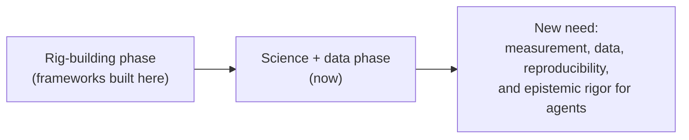
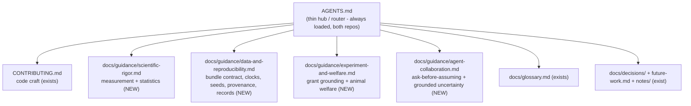

# Design review: agent guidance for scientific, data, and reproducibility rigor

- **Author / Agent:** Agent (Cursor) on behalf of Ravi
- **Date:** 2026-08-30
- **Status:** Review + recommendation (no framework edits in this document)
- **Scope:** The project's *agent-facing frameworks and guidelines* across **both**
  repositories (`os_code_t_maze` and the sibling `os_code_t_maze_resources`) -
  judged as the thing that shepherds fast, often AI-written change. The question:
  what is missing that would give future agent work the motivating context,
  thought-styles, and rigor that *science, data, and reproducibility* demand?

This is a written review, not a rewrite. It inventories the guidance we have today,
grades it honestly against the scientific mission, diagnoses the recurring gaps
using concrete evidence from the decision log and bug history, and recommends a
concrete target plus a safe, staged path. It is written for a lab with mixed coding
backgrounds; technical terms are glossed on first use and also live in
[`docs/glossary.md`](../glossary.md).

---

## 0. TL;DR

- **The existing frameworks are strong - but they are almost entirely about
  *software-engineering* craft.** [`AGENTS.md`](../../AGENTS.md) and
  [`CONTRIBUTING.md`](../../CONTRIBUTING.md) fight *comprehension debt* extremely
  well (pure core + thin shell, capped change size, human author of record, ADRs
  for "why", plain language for non-CS readers). What they do *not* codify is
  *scientific* rigor: whether a computed number means what it claims, how to reason
  about confounds, how to keep data trustworthy and reproducible, and how an agent
  should express uncertainty.
- **The decision log already paid for these lessons - one case at a time.** A whole
  cluster of ADRs exists because agents shipped subtly-wrong behavioural measures
  (bug `#260720_BehaviorStatError`, ADR-0092/0093/0094/0095); clocks and time-bases
  trip people repeatedly (ADR-0064/0101/0124/0128); reproducibility caveats are
  re-explained per ADR (ADR-0059/0086/0140); records integrity spans both repos
  (bug `#260810_RecordsIntegrity`, ADR-0097/0105). None of this hard-won knowledge
  is written down as *standing guidance* an agent reads before it repeats the
  mistake.
- **The timing is right.** The project is pivoting from *building the rig* to
  *collecting and analysing data* for a K99/R00 grant, and the analysis layer is
  being carved into its own repo (FW-0048, ADR-0142/0143). The frameworks were
  written for the engineering phase; the science/data phase needs its own guidance.
- **Recommendation: a hub-and-spoke restructuring.** Keep each repo's `AGENTS.md`
  as a thin, always-loaded *hub* that routes to scoped *spoke* documents read on
  demand. Add four rigor spokes the frameworks currently lack: **scientific
  rigor** (measurement + statistics), **data & reproducibility** (the bundle as a
  contract, clocks, seeds, provenance), **experiment & welfare** (grant grounding +
  animal welfare), and **agent collaboration** (ask-before-assuming + grounded
  uncertainty).
- **This review ships:** this document plus deferred-work entries (FW-0053/0054/0055)
  capturing the migration. It is **recommend-only** - it does *not* edit `AGENTS.md`
  or `CONTRIBUTING.md`, and it writes no ADR yet (the eventual record is named
  ADR-0146) so the human can approve the split first.

A "**spoke**" here is a scoped guidance document; the "**hub**" is the short index
that points to the right spoke for the task at hand.

---

## 1. Why this matters now

The frameworks were built during the *rig-building* phase, and they are excellent
at it. Their explicit target is **comprehension debt** - "the compounding gap
between the volume  of code in this repo (much of it written fast, often with an AI
agent) and what the humans inthe lab actually understand about it"
([`CONTRIBUTING.md`](../../CONTRIBUTING.md)). Every rule there serves *human
understanding of code*.

Two things have changed:

1. **The work is becoming science, not just software.** The rig now runs cue-guided
   sessions; the code that matters most is increasingly the code that *measures*
   behaviour (`phase3_stats`, `behavior_stats`, the whole `tmaze.analysis` layer)
   and that *stores* it (the session bundle). A bug in a widget is annoying; a
   quietly-wrong accuracy number or a mis-aligned clock can corrupt a scientific
   conclusion or an animal's record without anyone noticing.
2. **The data is becoming an interface.** ADR-0142 severed the code coupling
   between the rig and the analysis, and the analysis layer will move to its own
   repository (FW-0048). The on-disk bundle is now *the contract* (see the
   companion review [`data-format-review.md`](data-format-review.md)). Data
   discipline is no longer housekeeping; it is an interface guarantee.

An agent starting a task today is handed a rich, correct set of *engineering*
conventions and essentially no *scientific* ones. It has to re-derive "a reaction
time you can't characterise the latency of is not a reaction time" (ADR-0094) or
"a stated confidence is not a measurement" from scratch, every time. That is the
comprehension-debt argument applied to scientific method: knowledge that outruns
what is written down.

---

## 2. Current-state inventory

What the guidance surface covers today, across both repos.

### 2.1 `os_code_t_maze` (the code repo)

| Document | Role | Covers well | Rigor coverage |
|---|---|---|---|
| [`AGENTS.md`](../../AGENTS.md) | Always-loaded maintenance contract | Orientation map; AI-assisted change rules (human author of record, cap change size, check the working tree first); plain-language rule; keep `PROGRAMS.md`/ADRs/future-work/notes current | Points at the grant + protocol PDFs for context, but sets no *scientific* expectations; "explain for a non-specialist" is about prose, not method |
| [`CONTRIBUTING.md`](../../CONTRIBUTING.md) | Code-craft companion | The nine guidelines (pure core + thin shell, small cores, tests as the comprehension contract, comments explain intent, every magic number points to a reason, boring over clever, one canonical way, shared vocabulary, commits narrate why) | Guideline 5 ("every magic number points to a reason") and 3 (tests) touch scientific values, but the frame is code comprehension, not measurement validity |
| [`docs/decisions/`](../decisions/) | Immutable ADR log ("why") | Superb: 144 ADRs, an index, a template, an immutability/supersede workflow | This is where scientific reasoning actually lives today - but per decision, not as reusable guidance |
| [`docs/glossary.md`](../glossary.md) | Plain-language term index | Domain + CS terms, incl. *endogeneity*, *behavioural mode*, *logistic regression* | Has the vocabulary of rigor without the *rules* of rigor |
| [`docs/future-work.md`](../future-work.md) | Deferred-change backlog | Structured `FW-NNNN` entries with motivation/approach/evaluation | Captures deferred rigor work (FW-0039 git SHA, FW-0047 schedule-aware bias) but doesn't set standing expectations |
| [`docs/notes/`](../notes/) | Human capture inbox | Raw bug/idea jottings; agent triage rules | Where the raw signals of the rigor gaps first appear |
| [`.cursor/rules/conventions.mdc`](../../.cursor/rules/conventions.mdc) | Auto-attached nudges | Points at the canonical sources without duplicating them | Establishes the *pattern* this review extends: a thin nudge that routes to a canonical doc |

### 2.2 `os_code_t_maze_resources` (the sibling repo)

| Document | Role | Covers well | Rigor coverage |
|---|---|---|---|
| [`../os_code_t_maze_resources/AGENTS.md`](../../../os_code_t_maze_resources/AGENTS.md) | Always-loaded folder guide | A precise file map; conventions (scripts resolve paths relative to `__file__`); a versioning policy; maintenance rules; a dated **Change Log** | Owns the *records* discipline (sources of truth: `animals.json`, `daily_log.csv`, `session_annotations.csv`) but frames it as file-tidiness, not data integrity or reproducibility |

### 2.3 The imbalance, stated plainly

The frameworks answer *"how do I write code the lab can understand and maintain?"*
comprehensively. They do not answer *"how do I make a measurement the lab can
trust, store data that stays trustworthy, keep a result reproducible, and be honest
about what I'm unsure of?"* Every ADR in the clusters below is evidence that these
questions came up, were answered well once, and then were not turned into guidance.

---

## 3. Honest scorecard

Grades reflect the guidance surface as *standing, reusable direction for an agent*
(not whether the codebase got the answer right in a given ADR - it usually did).
Scale: Strong / Good / Fair / Weak.

| Rigor dimension | Grade | Evidence / reasoning |
|---|---|---|
| **Code comprehensibility** | **Strong** | The whole of `CONTRIBUTING.md` + the AI-change rules in `AGENTS.md`; enforced by tests and the architecture boundary test (ADR-0083). |
| **"Why" is recorded** | **Strong** | 144 ADRs with an immutability/supersede workflow; deferred work in `future-work.md`. Best-in-class. |
| **Measurement validity** | **Weak** | No guideline asks "does this number mean what it claims?" The `#260720_BehaviorStatError` cluster (ADR-0092/0093/0094/0095) is four separate corrections of misleading stats that a standing checklist would have caught. |
| **Confound / causal discipline** | **Weak** | Endogeneity is defined in the glossary and handled beautifully in ADR-0112, but no rule tells an agent to flag observational-vs-causal claims or hidden confounds. |
| **Clocks / time-bases / units** | **Fair** | The knowledge exists (ADR-0064/0101/0124/0128; `data-format-review.md` §2.2 lists five clocks) but only as per-decision lore; open bugs `#260720_DataVideoSync` / `#260720_DataLogging` are exactly this. No "declare your clock and units" rule. |
| **Reproducibility** | **Fair** | Real strengths (config snapshot + SHA-256, ADR-0072; idempotent rebuilds, ADR-0081; seed determinism, ADR-0047). But caveats are re-derived per ADR (ADR-0059/0086/0140) and code version is still unstamped (FW-0039). No standing reproducibility rule. |
| **Data as a contract** | **Good** (rising) | `data-format-review.md` + ADR-0142/0143/0144 are landing this now; it deserves to become standing guidance, not just a one-time review. |
| **Grant / hypothesis grounding** | **Fair** | `AGENTS.md` points to `BRAINK99_Drieu.pdf` and the ACUC protocol; individual ADRs cite the literature well (Drieu 2025 in ADR-0115, Duvelle 2024 in ADR-0134). But "tie a new measure to a hypothesis and cite it" is not a rule. |
| **Animal-welfare rigor** | **Fair** | Real mechanisms exist (water accounting ADR-0084/0106; <90% baseline flags; intervention welfare caps ADR-0086/0107) but scattered; no guideline says "a change must not silently degrade a session or a welfare record." |
| **Records integrity (cross-repo)** | **Fair** | Sources of truth + guardrails are strong (ADR-0075/0081/0085/0097/0105) but the discipline lives half in each repo's `AGENTS.md`; `#260810_RecordsIntegrity` shows how drift crosses the repo boundary. |
| **Agent epistemics** | **Weak** | Nothing codifies surfacing questions before acting, or expressing grounded uncertainty / flagging work that needs checking. `AGENTS.md`'s autonomy note is the closest, and it points the other way (prefer deciding over asking). |

**Reading of the scorecard:** the *engineering* rows are strong; every *scientific*
row is Fair or Weak, and the Weak ones (measurement validity, causal discipline,
epistemics) are precisely where a wrong answer is expensive and invisible.

---

## 4. The gaps, with evidence

Each gap below is a place where the codebase *already learned the lesson the hard
way* but never wrote it down as guidance.

### 4.1 Measurement validity is not a codified concern

The single clearest signal in the whole history. Bug `#260720_BehaviorStatError`
was a review of "every computed behavioral stat", and it produced four ADRs, each
fixing a distinct way a number lied:

- **ADR-0092** - an accuracy readout showed "80% [40/60]" (the percentage was over
  out-of-block trials; the bracket counted all trials). *Denominator mismatch.*
- **ADR-0093** - win-stay/lose-shift paired trials that were not actually adjacent
  (a forced block sat between them). *A measure computed over the wrong set.*
- **ADR-0094** - removed a "Choice RT" that was a host wall-clock interval carrying
  un-characterised serial/actuation latency, and hid a reward-rate that "pins ~100%
  by construction". *A number that does not measure what its name claims.*
- **ADR-0095** - split a side-bias readout that was hiding a directional pull.

Later ADRs keep re-establishing the same discipline (ADR-0108 reintroduces a
cue-zone dwell but insists it is "a RELATIVE, within-animal signal, NOT a reaction
time"; ADR-0132 aligns an offline baseline set to the live convention so two
readouts agree). **The recurring failure mode is shipping a number whose definition,
denominator, or units don't match its label.** A short *is-this-number-what-it-claims*
checklist, read before adding or changing a measure, would have caught most of them:

- What is the exact numerator and denominator, and over which set of trials/events?
- Is this descriptive or inferential? If inferential, what is the uncertainty?
- Does the name match the definition (esp. anything called a "rate", "time", or "bias")?
- What latency/clock does it inherit, and is that honest for the claim?
- What caveat must travel with it (and is that caveat in the tooltip/summary/doc)?

### 4.2 Confound / causal discipline is folklore

The glossary defines *endogeneity* and ADR-0112 handles the return-cue analysis
exactly right ("stays *observational* - only a randomised return-cue schedule could
make it causal"). But this is one agent getting it right, not a rule. Nothing tells
the next agent to ask "is this correlation being read as causation?" or "what
confound could produce this?" - the difference between a figure that supports the
grant and one that misleads it.

### 4.3 Clocks, time-bases, and units trip people repeatedly

A session mixes several clocks (`data-format-review.md` §2.2 enumerates five), and
the firmware session clock even *resets on a MODE switch* and is not board uptime
(ADR-0064). Getting this wrong is a standing hazard: ADR-0101 (deriving
hours-since-water from tolerant free-text times), ADR-0124 (making the bundle
self-anchor on one canonical `t0` because *two offline readers disagreed*), ADR-0128
(pinning the join time-base to local time, validated to one frame). Two open bugs -
`#260720_DataVideoSync` and `#260720_DataLogging` - are this exact class. There is
no standing rule to *declare the clock and the units* of any timestamp or quantity
an agent touches (which is also what ADR-0144's units/dtype dictionary needs).

### 4.4 Reproducibility is handled case-by-case

The codebase has genuine reproducibility strengths - a per-session config snapshot
with a SHA-256 per file (ADR-0072), idempotent rebuilds (ADR-0081), seed-deterministic
schedules (ADR-0047). But the *caveats* are re-explained every time: closed-loop
schedules where "seed alone no longer reproduces" (ADR-0086), the append-only extend
(ADR-0059), and ADR-0140 - which changed the RNG so "the same integer seed now yields
a DIFFERENT schedule" and had to spell out that historical data is still recoverable
from the logged per-trial schedule. Meanwhile the code version (git SHA) that produced
a session is still not stamped into the bundle (FW-0039). A standing reproducibility
rule - *pin and record seeds; state when seed-alone no longer reproduces; stamp code
provenance; prefer idempotent rebuilds over append* - would make each of these the
default instead of a rediscovery.

### 4.5 Grant / hypothesis grounding is implicit

The scientific *why* is well-referenced for context in `AGENTS.md`
(`research_question/BRAINK99_Drieu.pdf`, the ACUC protocol) and cited beautifully in
individual ADRs (Drieu et al. 2025 motivates the unrewarded probe blocks in ADR-0115;
Duvelle et al. 2024 the correct-choice trigger in ADR-0134; the VTE literature the
trajectory work in ADR-0128/0130/0133). But "when you add or change a *measure* or a
*task feature*, tie it to a grant hypothesis or the literature, and cite it" is not a
rule - it is a habit some agents happen to follow. Codifying it keeps analysis work
pointed at the questions the grant actually asks.

### 4.6 Animal-welfare rigor is scattered

Welfare shows up as mechanisms - water accounting that must reconcile and never
double-count (ADR-0084/0106), the <90%-baseline red flags, ad-lib regime handling
(ADR-0100), and welfare caps inside interventions (`max_block_len`, ADR-0086/0107) -
but not as a principle. There is no single line telling an agent that *a change must
not silently degrade a running session or an animal's welfare record*, which is the
one invariant a behavioural-rig codebase most needs stated out loud.

### 4.7 Records integrity spans both repos

The records system is a two-repo affair (rig writes bundles here; husbandry lives in
the resources repo), and drift crosses the boundary. Bug `#260810_RecordsIntegrity`
found non-real sessions becoming first-class rows, real sessions with no husbandry
row to join, and water *volumes* typed into water *time* columns. The response was a
strong set of guardrails (canonical identity ADR-0075; the session registry ADR-0081;
reversible surfaces ADR-0085; ignore-list + audit ADR-0097; acknowledge store ADR-0105).
But the *discipline* - sources of truth, keyed joins, one canonical identity - is
documented half in each repo's `AGENTS.md`. A shared data spoke, referenced from both
hubs, is the natural home.

### 4.8 Agent epistemics & collaboration are not codified

Two practices the human has adopted by hand have no home in the frameworks:

- **Checking whether the agent has questions before it acts.** Today this depends on
  the human remembering to ask, or on plan mode. `AGENTS.md`'s autonomy guidance
  actually leans the other way ("lean towards making independent decisions"), which is
  right for reversible choices but wrong for consequential or ambiguous ones - exactly
  the forks where a silent wrong assumption corrupts data or a session.
- **Stating how sure it is, and flagging work that needs double-checking.** This is
  valuable, but it needs the right form. A *numeric* self-confidence from a language
  model is a weak, poorly-calibrated signal and manufactures false precision. What is
  reliable is **grounded** uncertainty: distinguishing what the agent *verified* (read
  the code, ran the test, checked the doc) from what it *inferred* and from what it is
  *recalling or guessing*, flagging unverified claims, and naming what would verify
  them (a test, a bench measurement, a human review). This is the epistemic twin of
  two principles the repo already holds - *measurement provenance* (a number states
  what it is and its caveats) and *human author of record* (a human must be able to
  explain it). A claim an agent can't ground is like a number without units.

---

## 5. Options for structure

How to codify the above.

### Option A - Grow `AGENTS.md` / `CONTRIBUTING.md` in place
Add the scientific rigor content into the two existing documents.

- **Pros:** no new files; everything an agent needs in the always-loaded docs.
- **Cons:** these are already large; `AGENTS.md` is loaded on *every* session, so
  every addition taxes every task; mixing scientific method into a code-craft doc
  blurs both. Grows the monolith the review is trying to avoid.
- **Verdict:** insufficient on its own.

### Option B - One new monolithic "scientific rigor" document
A single large companion covering measurement, data, reproducibility, welfare, and
epistemics.

- **Pros:** one place to look; simple to reference.
- **Cons:** a second monolith; a task that only needs the measurement checklist
  still loads the welfare and data-format material; it will drift toward being
  bulk-read or unread.
- **Verdict:** better than A, but coarse.

### Option C - Hub-and-spoke (recommended)
Make each repo's `AGENTS.md` a thin, always-loaded **hub** that routes to scoped
**spoke** documents read on demand. This is the pattern the repo already endorses:
`AGENTS.md` tells agents to "read on demand, don't bulk-read", and
`.cursor/rules/conventions.mdc` already keeps "canonical sources, deliberately
un-duplicated". It extends what exists (`CONTRIBUTING.md` is already a spoke) rather
than inventing a new idea.

- **Pros:** each task loads only the guidance it needs; each spoke has one owner and
  one purpose; new rigor areas become new spokes without bloating the hub; preserves
  the single-source-of-truth ethos.
- **Cons:** more files; the hub must be kept an accurate router (a light maintenance
  rule handles this, exactly as the file-map rules already do).
- **Verdict:** **recommended.**

---

## 6. Recommendation

Adopt the **hub-and-spoke** structure and add the four missing rigor spokes.

The four new spokes (all in the code repo; cross-referenced from the resources
hub so the records discipline is shared, not duplicated):

1. **`scientific-rigor.md` - measurement + statistics.** The
   *is-this-number-what-it-claims* checklist (§4.1); descriptive vs inferential
   discipline and when uncertainty must be reported; the confound/causal rule -
   flag observational-vs-causal claims and name the confound (§4.2); a short
   convention for statistical choices (e.g. proportions get a confidence interval,
   as ADR-0133 already does with Wilson intervals). Grounded in the existing ADRs
   as worked examples.
2. **`data-and-reproducibility.md` - the data contract + reproducibility.** Elevates
   `data-format-review.md` from a one-time review to standing guidance: the bundle
   is the interface; declare the clock and units of every timestamp/quantity (§4.3);
   pin and record seeds and state when seed-alone no longer reproduces; stamp code
   provenance; prefer idempotent rebuilds; sources of truth and keyed joins for the
   cross-repo records (§4.4, §4.7).
3. **`experiment-and-welfare.md` - grant grounding + welfare.** Tie a new measure or
   task feature to a grant hypothesis or the literature, and cite it (§4.5); the
   welfare invariant - a change must not silently degrade a session or a welfare
   record - with pointers to the water-accounting and baseline-flag mechanisms (§4.6).
4. **`agent-collaboration.md` - epistemics + working with the human.** Surface open
   questions and key assumptions on consequential or ambiguous forks (but don't
   over-ask on reversible defaults - this refines, not contradicts, the autonomy
   guidance); express **grounded** uncertainty - verified vs inferred vs
   recalled/guess - flag unverified claims and name what would verify them;
   explicitly *avoid* numeric self-confidence theatre (§4.8).

**Why grounded, not numeric, uncertainty (recorded here so the choice is legible):**
verbalized confidence from a language model is known to be poorly calibrated, so a
stated "90% sure" is not a reliable probability and invites false precision. The
signal that *is* reliable is provenance - whether the agent checked the claim against
the code, a test, or a document. Tying uncertainty to grounding makes it verifiable
and consistent with how the rest of this project already reasons about numbers and
about the human author of record.

The hub keeps a one-line-per-spoke routing table and a short rule: *"when you touch a
measurement, data, an experiment parameter, or an animal's record, read the matching
spoke first."*

---

## 7. Staged, backward-compatible migration

Every stage is independently shippable and reviewable; none breaks the existing
always-loaded contract until the human approves the split.

- **Stage 0 (this task): review + capture.** This document and the future-work
  entries (FW-0053/0054/0055). No edits to `AGENTS.md`/`CONTRIBUTING.md`; no ADR yet.
- **Stage 1: decide + record.** If the direction is accepted, write **ADR-0146**
  (agent-guidance hub-and-spoke + rigor spokes) and add its index row. This is the
  point where the decision becomes immutable and citable.
- **Stage 2: author the spokes.** Create the four spoke documents (FW-0053), each
  small and worked-example-driven from the ADRs cited above. Add the glossary terms
  (FW-0055: *descriptive vs inferential*, *grounded uncertainty / verification
  status*, *measurement provenance*).
- **Stage 3: slim the hubs + add the checklist to the workflow.** Turn both repos'
  `AGENTS.md` into thin routers pointing at the spokes; add the
  *is-this-number-what-it-claims* checklist and the ask-before-assuming /
  grounded-uncertainty norm to the pre-commit/PR reminders (FW-0054). Update the
  `os_code_t_maze_resources` Change Log per its maintenance rule.

Because Stage 0 changes nothing an agent already relies on, and each later stage is
additive, no in-flight work is disrupted.

---

## 8. What this task delivers

- This design review (`docs/design/agent-guidance-rigor-review.md`).
- **FW-0053** - author the four rigor spokes and slim both `AGENTS.md` hubs.
- **FW-0054** - add the measurement-rigor checklist + the ask-before-assuming /
  grounded-uncertainty norm to the commit/PR workflow reminders.
- **FW-0055** - add the supporting glossary terms.
- **No** edits to `AGENTS.md`, `CONTRIBUTING.md`, the resources repo, or any code;
  **no** ADR file (the eventual record is named ADR-0146, to be written once the
  split is approved).

---

## 9. Glossary pointers

Terms this review leans on (fuller or new entries belong in
[`docs/glossary.md`](../glossary.md) when the spokes land): *comprehension debt*
(the volume-vs-understanding gap the frameworks fight); *endogeneity* (already
defined; a predictor partly caused by the behaviour it explains); *measurement
provenance* (a number stating what it is, its units, and its caveats); *grounded
uncertainty / verification status* (verified vs inferred vs recalled - the reliable
alternative to a numeric confidence); *descriptive vs inferential* (reporting what
was observed vs. drawing a statistical conclusion, which needs an uncertainty);
*source of truth* (already defined; the one authoritative copy others derive from);
*hub-and-spoke* (a thin always-loaded index routing to scoped docs read on demand).
