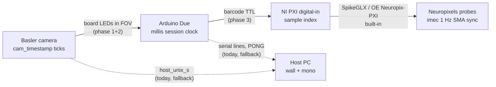

# Design: synchronizing the video, Arduino, and Neuropixels streams

- **Author / Agent:** Agent (Cursor) on behalf of Celine
- **Date:** 2026-09-02
- **Status:** Proposal (no code changes in this document; later ADRs will cite it)
- **Scope:** How the three data streams a session produces — the overhead
  **video**, the **Arduino** event stream (beams, licks, rewards, cues), and the
  future **Neuropixels** recording — get put on one shared time axis, precisely
  enough that a spike, a video frame, and a beam break can be compared. It covers
  (1) reading the indicator LEDs already on the rig's electronics board out of the
  video, (2) adding two cue LEDs, and (3) a later dedicated pseudorandom sync line.

This is a design proposal, not an implementation. It states what exists today,
the target, a staged path, and the open questions to settle on the bench. It is
written for a lab with mixed coding backgrounds; technical terms are glossed on
first use and also live in [`docs/glossary.md`](../glossary.md). The companion
backlog entries are FW-0045 (board-LED detection), FW-0056 (cue LEDs), and
FW-0018 (dedicated sync line) in [`docs/future-work.md`](../future-work.md).

---

## 0. TL;DR

- **Today, alignment is "trust the PC's clock".** Trial events are stamped with the
  host wall clock, video frames with the host wall clock, and the two are joined
  by time. That is tens-of-milliseconds accurate and carries the serial-port
  delay; the Arduino's own hardware clock is written to disk but never used. There
  is no link at all to a neural recording yet.
- **The electronics board next to the maze is already a sync device.** Its
  optocoupler modules carry indicator LEDs that light whenever a body sensor is
  triggered or a solenoid fires — and the board is in the camera's field of view.
  Every one of those flashes is the *same electrical edge* the Arduino
  timestamps. Reading the LEDs out of the video gives a direct video↔Arduino
  clock fit with hundreds of points per session, **with no hardware or firmware
  change** (Phase 1).
- **Two cue LEDs on spare optocoupler channels** extend that to cue onsets, which
  currently have no visible marker (Phase 2). One wire per cue from a free Due
  pin; the module's own indicator LED does the rest.
- **A pseudorandom sync line, later**, ties the Arduino to the Neuropixels
  acquisition (one TTL into the NI digital-input card) and gives a drift-proof
  fiducial that all three streams see (Phase 3).
- **Design principle:** the Arduino's millisecond clock is the hub every other
  clock is fitted to; the host clock is only a coarse bridge and a fallback.
  Whenever a link is missing the system must say so and fall back to today's
  behaviour — never produce a silent wrong fit.

A **fiducial** is a landmark visible in more than one stream at once, used to line
them up (like a clapperboard in film). A **clock fit** is the straight line
`time_in_stream_B = offset + rate * time_in_stream_A` estimated from matched
fiducials; **drift** is the slow change of that offset over a session because no
two clocks tick at exactly the same speed.

---

## 1. Where we are

### 1.1 The clocks in a session bundle

[`data-format-review.md` §2.2](data-format-review.md) lists five time-bases.
The ones that matter here:

| Clock | Where | What it is | Used for alignment today? |
|---|---|---|---|
| `session_t0_*` | manifest, CSV headers, sidecar header | The canonical session zero: host wall + monotonic + ISO at Start Session (ADR-0124) | Yes — the anchor |
| `*_iso` columns | trial / excursion CSV | Host wall clock at the moment the host *decided* to act (includes ~ms serial delay) | Yes — joined to `host_unix_s` |
| `host_unix_s` | video sidecar, per frame | Host wall clock (`time.time()`) at frame grab | Yes |
| `cam_timestamp` | video sidecar, per frame | The Basler camera's **own hardware clock**, in ticks, at exposure | **No** (written every frame; blank if the driver gives none) |
| firmware `<ms>` | serial log (`serial/`), `lick_fw_ms`, `rig_ms` | Arduino `millis()` since session start; **resets on a MODE switch** (ADR-0064) | **No** (write-only) |

The analysis repo (`drieu_lab_analysis`) aligns trials to frames by converting
`*_iso` to epoch seconds and slicing the sidecar on `host_unix_s`; it does not
read the serial log at all. The `#260720_DataVideoSync` entry in
[`docs/notes/Bugs.md`](../notes/Bugs.md) asks whether this is actually correct —
nobody has measured it.

### 1.2 What the Arduino already emits

- Four **5 ms TTL pulses** intended for a neural-acquisition digital input:
  choice, return-arm, tone-on, tone-off on Due pins 4–7
  (`firmware/common/rig_config.h`, `PIN_TTL_*`; ADR-0044, ADR-0063). None of them
  is wired to anything yet (`CONFIRM wired`).
- **No** reward TTL, no periodic sync pulse, no barcode, no camera trigger.
- A `PING`→`PONG` at Start Session, giving one point where host wall time and
  firmware ms are written together (ADR-0048, ADR-0124).

### 1.3 Camera facts that shape the design (verified in `ui/camera_view.py`)

- Default recording is **lossless FFV1** (`RECORD_FORMATS[0]`); H.264 is an
  operator choice. Small LEDs survive lossless recording intact; under H.264 they
  can smear. The detector must be validated on FFV1 and warned about on H.264.
- Frames are **undistorted at the source** (ADR-0015; `_maybe_undistort` on the
  grab thread), so preview, tracking, and the saved video share the corrected
  geometry. Any LED regions we define live in that corrected image space, and
  the sidecar header records whether undistortion was on.
- `cam_timestamp` is `grab.TimeStamp` cast to int, written every frame, blank if
  unavailable. Its tick rate is **not documented** in this repo and must be
  measured (Basler documents it per model; a fit against `host_unix_s` over a
  session will also reveal it).
- **Exposure and gain are left at the camera's power-up defaults**; no `.pfs` is
  loaded unless the operator picks one. If the camera auto-exposes, a blinking LED
  bank at the frame edge could nudge exposure and make thresholds unstable.
- The camera runs **free** at roughly 25–42 fps (no hardware trigger; ADR-0011).
  A 5 ms TTL pulse is therefore invisible to the camera; only events that last
  longer than a frame period (a beam break, a 300 ms reward pulse, a whole tone)
  can be seen.

### 1.4 The electronics board (from the rig photo and `generate_rig_manual.py`)

The board sits on the wall to the right of the maze, inside the camera's field of
view but at the **far edge of the frame** (where lens distortion is strongest
and pixels-per-cm is lowest). It carries the Arduino Due, OPI104-HS optocoupler
breakouts (Due → 24 V solenoid drivers) and MT-301R4P-N 4-channel
optocoupler / level-shifter modules (12 V Banner sensors → 3.3 V Due). Each
module channel has an indicator LED (red in the photo) that lights when its
input is active; a steady green power LED is also visible. **Nothing lights for a
cue** — the cue is an analog waveform on DAC0, not a digital line.

---

## 2. Target: the clock chain

The Arduino is the hub. Every other stream is fitted *to* the Arduino's
millisecond clock through a hardware link, and the host clock is kept only as a
coarse bridge and the fallback.

Why this shape:

- **Camera ↔ Arduino via LEDs** costs nothing new for sensors and rewards (Phase 1)
  and two wires for cues (Phase 2). The LEDs are self-illuminating landmarks in a
  dim room, which also makes them ideal for finding the board in the image.
- **Arduino ↔ NI via one TTL barcode** (Phase 3). Neuropixels acquisition over PXI
  (SpikeGLX, or Open Ephys with the Neuropix-PXI plugin) already synchronizes the
  probes to the NI digital card using the imec basestation's 1 Hz SMA sync
  square wave. So the Arduino only has to reach **one NI digital-input line**;
  probe↔NI is handled by the acquisition software.
- **Host stays a bridge.** `host_unix_s` and `*_iso` still give the coarse first
  guess that makes matching fiducials unambiguous, and they remain the alignment
  when no hardware link is present.

### Precision targets

| Link | Target | How it is met |
|---|---|---|
| video ↔ Arduino | within one frame period (~25–40 ms), with the *sub-frame* mean offset estimated from many events | LED edges (Phase 1/2), robust linear fit |
| Arduino ↔ NI (probes) | sub-millisecond | barcode TTL decoded at the NI sample rate (Phase 3) |
| drift over a > 1 h session | bounded by the fit's rate term; verified by residuals over time | continuous events (Phase 1) or periodic barcodes (Phase 3) |
| any link missing | loud verdict + fallback to today's host-t0 join | every phase |

---

## 3. Phase 1 — read the existing board LEDs (no hardware or firmware change)

**Goal.** From a recorded session (video + sidecar + serial log), recover for each
board LED the frames where it turned on/off, match those edges to the
corresponding serial events, and fit `cam_timestamp ↔ firmware ms`.

### 3.1 LED inventory (to be filled on the rig)

A one-time table, kept in the new `host/led_map.json` (below). One row per
indicator LED:

| Field | Meaning |
|---|---|
| `led_id` | short stable name, e.g. `beam_entry`, `sol_center_r2`, `power` |
| `module`, `channel` | which physical module / channel the LED belongs to |
| `colour` | `red` / `green` / … (drives the colour-channel trick below) |
| `event` | the serial event it mirrors: `S,<beam>` edge for a sensor, `SOL,<port>,<idx>` / `REWARD` for a solenoid, `CUE,ON/OFF,<band>` for a cue LED (Phase 2), `always_on` for the power LED |
| `polarity` | whether the LED is lit when the beam is *broken* or *intact* (unknown until measured; the correlation sign settles it) |
| `board_xy` | position in a flat "board frame" (any consistent unit, e.g. mm from a corner) — the **constellation** |
| `ref_px` | pixel centroid in the reference image, when the map was made |

### 3.2 Detection (per LED, per frame)

- A small **region of interest (ROI)** around each LED, derived from the
  registered constellation (§3.4), not hard-coded pixels.
- Brightness measured **relative to a local background ring** around the ROI, so
  room-light changes and exposure wobble do not create false edges.
- For red LEDs use **red minus green** rather than grey; it separates an LED from a
  reflection far better on a colour camera.
- **Hysteresis** (turn on above one threshold, off below a lower one) plus a
  minimum on-duration of one frame, to avoid chatter.
- Output per frame: on/off per LED; per session: a list of rising and falling
  edge frames per LED with their `cam_timestamp`, `host_unix_s`, and `frame_idx`.

### 3.3 Mapping LEDs to events (once, then verified every session)

The mapping *could* be typed in by hand from the wiring, but the wiring labels
have already been wrong once (see the beam-name aliases in `rig_config.h`). So:

1. **Mapping session.** With no rat, run `tmaze_test` and the camera: fire each
   solenoid a few times, break each beam by hand a few times, play each cue.
   The serial log then contains a clean, sparse event train per event type.
2. **Cross-correlate.** For every blinking blob found in the video (§3.4) and
   every event type in the serial log, cross-correlate the blob's on/off trace
   with the event train over a coarse window (the host-clock join gives the
   starting alignment within ~100 ms). The pair with the dominant peak is the
   binding; the peak position is the lag; a negative peak flips `polarity`.
3. **Write `led_map.json`.** Bindings, polarities, constellation, reference
   pixel positions, and a small reference crop of the board.

Every subsequent session repeats step 2 *passively* on its own events (the rat
breaks every beam dozens of times; rinse/drain fire at every trial start per
ADR-0010; the reward valve fires every rewarded trial) and reports a per-LED
verdict: **`matched`** (clear peak at a plausible lag), **`silent`** (the ROI
never changed), **`displaced`** (a blob elsewhere correlates with that event
train — the board or camera moved). No manual beam triggering is ever required
for the check.

### 3.4 Finding the board every session: constellation registration

The board is flat and the camera is fixed, so if either moves between sessions
the LED pattern moves in the image as one rigid shape — to first order a
**similarity transform** (rotation + translation + a little scale), or a
**homography** if the board tilts. Rather than trusting stored pixel positions:

1. Build a **max-minus-median image** over the first few minutes of video (or the
   roll-call window, §4.3): every LED that blinked shows up as a bright blob;
   everything static cancels.
2. Threshold → blob centroids → the *observed* point set.
3. Match it to the stored `board_xy` constellation (Procrustes with RANSAC for a
   similarity; a 4-point homography if needed; with 10–15 points brute force is
   fine) and derive every ROI from the fitted transform.
4. **Break the grid ambiguity with time.** Each MT-301R4P-N has four identical
   channel LEDs in a row, so a shift by one channel pitch looks geometrically
   like no shift. The Arduino-driven LEDs (cue LEDs, rinse/drain, later the sync
   LED) blink at *known* times and label their blobs unambiguously; the always-lit
   green power LED is a landmark even before anything fires. Geometry places the
   rest.
5. Report the fitted transform and its residual; a large residual or too few
   blobs is a **loud** `registration_failed` verdict, and the pipeline falls back
   to the host-t0 join for that session.

This makes retroreflective markers unnecessary: the LEDs are active landmarks and
the room is dark. Markers remain a fallback if a future board has too few LEDs
to register. A secondary cue — template/phase correlation of the reference board
crop against the current frame — can estimate translation before any LED fires,
but under the rig's lighting it is a check, not the primary method.

### 3.5 The clock fit

For each LED with verdict `matched`, pair each detected edge with its serial
event (nearest in host time, then refined by the mapping lag). Each pair is a
point (`firmware_ms`, `cam_timestamp`). Then:

- Fit a **robust straight line** (e.g. Theil–Sen or RANSAC least squares) per
  **MODE segment** — the firmware clock restarts on every `MODE` switch
  (ADR-0064), so each segment gets its own offset, sharing the rate.
- Report **residuals**: their spread is the camera-exposure + detection jitter;
  their mean per event type is the systematic delay between the electrical edge
  and the visible flash (expected: microseconds for the optocoupler, plus the
  Arduino's 5 ms sensor debounce, plus up to one frame of exposure). Residual
  trend over time is drift the rate term did not absorb.
- Bridge to the host clocks via the sidecar's `host_unix_s` on the same frames;
  the difference between the LED-based fit and the current `*_iso` join **is the
  measured answer** to `#260720_DataVideoSync`.

### 3.6 Outputs and where the code lives

Agreed home: the **rig repo**, so the bundle carries the fitted alignment and the
analysis repo only reads it (keeping the bundle the single contract,
ADR-0142/0143).

| Artifact | Path in the bundle | Content |
|---|---|---|
| LED events | `sync/led_events_<id>.csv` | one row per detected edge: `led_id, edge, frame_idx, cam_timestamp, host_unix_s, matched_event, firmware_ms, residual_ms` |
| Clock fit | `sync/clock_fit_<id>.json` | per-segment `offset`, `rate`, residual stats, per-LED verdicts, registration transform + residual, `method: led-fit`, versions |
| Config snapshot | `config/led_map.json` | copied at Start Session via `session_config.HOST_CONFIG_FILES` like `zones.json` (ADR-0072) |

Manifest: register `sync_led_events` / `sync_clock_fit` via
`SessionManifest.set_stream`, and let `fiducial.method` take the value `led-fit`
(today `host-t0`). `format.json` should list the new stream and its columns.

Code map (respecting the pure-core / thin-shell rule in
[`CONTRIBUTING.md`](../../CONTRIBUTING.md)):

- `tmaze/vision/led_detector.py` — ROI brightness, hysteresis, edge extraction
  (OpenCV/NumPy, no Tk).
- `tmaze/core/sync/` — constellation registration, event matching, robust fit,
  verdicts (stdlib + NumPy, headless-tested with synthetic traces).
- `tmaze/tools/sync_fit.py` — the offline runnable, modelled on
  `maze_state_validate.py`: reads a bundle, writes the two `sync/` artifacts,
  prints a report; `--selftest` on synthetic data; `--map` mode that builds
  `led_map.json` from a mapping session.
- Later: a live **preflight** in `camera_view` (§4.3). There is no generic
  per-frame detector hook today — tracking is dispatched to a worker through a
  `LatestFrameSlot` (ADR-0040) — so a second slot + worker, or a subscriber on the
  grab thread, would be needed. Offline first; live is an add-on.

The analysis repo reads `clock_fit` and applies it when converting `firmware_ms`
or `cam_timestamp` to the session axis; nothing else there changes.

---

## 4. Phase 2 — cue LEDs on spare optocoupler channels

### 4.1 Hardware

The cheapest camera-visible cue marker is a **spare channel on an existing
MT-301R4P-N module**: wire a free Due pin to the channel's input, and the
module's own indicator LED becomes the marker. The channel's isolated output is
left unused (or becomes a spare TTL later). One channel per cue *tone*.

Install checklist (hardware; recorded in the rig manual when done):

1. Count spare MT-301R4P-N channels; need two (three if a return-cue LED is
   wanted). If none are spare, an OPI104-HS breakout works the same way.
2. Confirm the module's **input side accepts 3.3 V logic** (the Due is 3.3 V and
   its pins source only a few mA — do not drive a bare LED from a pin). The
   module's input LED + series resistor is exactly the load the Due can handle.
3. Confirm the module input polarity (active-high vs active-low) and wire the
   common ground.
4. Proposed pins (unused today; pins 0–1 are the console UART, 4–7 the TTLs):
   `PIN_LED_CUE_LOW = 8`, `PIN_LED_CUE_HIGH = 9`, optional
   `PIN_LED_CUE_RETURN = 10`. Add to `rig_config.h` and the rig manual's pin table
   (which also still lacks TTL pins 4–7).
5. Photograph, then add the two LEDs to `led_map.json` (`event: CUE,ON,low` /
   `CUE,ON,high`) and re-run the mapping session.

### 4.2 Firmware

- The LED must be a **level held for the whole tone**, not a 5 ms pulse, or the
  camera will not see it.
- Cue identity in the firmware is a **frequency**, not a side: `handleCueOn()`
  (`cue-guided-task.ino`) resolves `freq` from the trial's correct arm, the
  return-cue coin flip, or a host-supplied Hz (ADR-0046). Pick the LED by which
  band `freq` falls in — nearer `cfg.lowToneHz` or `cfg.highToneHz` (midpoint
  split) — so the LEDs mean "low tone" / "high tone", the only identity the
  firmware reliably has. (Alternative, if ever needed: an explicit LED index
  field on `CUE_ON`.)
- Set the pin HIGH in `handleCueOn()` right where `startToneAsync()` is called
  (the cue kind and `freq` are known there; `startToneAsync` itself only sees
  a frequency), and LOW in `handleCueOff()` next to `stopToneAsync()`. Also
  clear both pins in the MODE-reset path so a mode switch mid-tone cannot leave
  an LED stuck on.
- **Optional `LEDTEST` command** for the roll-call (§4.3): `LEDTEST,<mask>,<ms>`
  drives the cue-LED pins (and any future sync LED) *without* the DAC, and echoes
  `<ms>,LEDTEST,<mask>` so the serial log carries it and it can never be mistaken
  for a real cue. This is a protocol change: update `firmware/PROTOCOL.md`, bump
  `PROTO_VERSION`, and teach `tmaze.core.protocol` the new line type.

### 4.3 Session-start roll-call (preflight)

A two-second active check before the rat goes in, using only LEDs that can be
fired **without side effects**: the cue LEDs (via `LEDTEST`, silently), the
rinse/drain solenoids (they fire at every trial start anyway and dispense
nothing to the rat), and later the sync LED. **Never the reward valve, and no
manual beam triggering** — the passive check (§3.3) covers beams within the
first trials. The roll-call gives the experimenter a live "all Arduino-driven
LEDs visible, board where expected" verdict and gives the registration (§3.4)
its time-labelled anchor blobs before the rat produces any events.

---

## 5. Phase 3 — a dedicated pseudorandom sync line (later)

**Goal.** One fiducial that every stream sees, independent of behaviour, at a
known cadence, so the fit is drift-proof even in a quiet session and extends to
the neural recording.

- **Electrical.** One Due pin emits a **barcode**: a pseudorandom on/off pattern
  encoding a sequence number, repeated every N seconds. It goes (a) into one
  **NI digital-input line** on the PXI chassis (3.3 V TTL is within NI's TTL
  thresholds; confirm the card), and (b) is echoed on serial as
  `<ms>,SYNC,<seq>` (ADR-0002: only a firmware re-emit reaches every logger).
- **Two rates, one sequence.** The standard Allen / Open Ephys barcode (32 bits,
  10 ms per bit, every 30 s) is ideal for the NI card and has existing decoders,
  but it is invisible at ~30 fps. So drive a **second Due pin → a spare
  optocoupler channel LED** with a **slow** pattern: bits of ≥ 3 frame periods
  (e.g. 100 ms), an 8-bit code every ~10 s. Both patterns come from the same PRNG
  sequence number, so a decoded camera code and a decoded NI code name the same
  `seq`. The simpler alternative — one slow pattern feeding both NI and LED — is
  acceptable if the ~100 ms bit period still gives sub-ms edges on NI (it does;
  the edge timing, not the bit period, sets precision). Decide on the bench.
- **Fit.** Decode barcodes on NI → (`firmware_ms`, `ni_sample`) pairs → robust
  line. Combine with the Phase 1/2 camera fit to place video frames on the probe
  axis. Report all three residual sets.
- **Roll-call and registration** gain a guaranteed, behaviour-independent
  time-labelled LED.

This is FW-0018, retargeted from the Open Ephys acquisition-board I/O to
Neuropixels PXI / NI digital-in.

---

## 6. Risks and open questions

| Risk / question | Mitigation or how to settle it |
|---|---|
| LEDs are only a few pixels at the frame edge | Sum over the ROI; validate on real footage; consider a slightly wider lens crop or a small mirror only if detection is marginal |
| H.264 smears small LEDs | Detector validated on FFV1 (the default); warn in the report when the sidecar header says H.264 |
| Auto-exposure reacts to the LED bank | Pin exposure/gain with a `.pfs` loaded at start; the local-background-ring measure also desensitizes thresholds |
| `cam_timestamp` tick rate unknown / blank frames | Measure from the sidecar (ticks vs `host_unix_s` slope); fall back to `host_unix_s` for frames with a blank tick |
| Grid self-similarity mis-registers by one channel | Time-labelled anchors (§3.4 step 4); refuse to fit if no anchor blob is present |
| Firmware clock resets on MODE | Per-segment offsets (§3.5); segment boundaries from the serial log's `MODE` lines |
| Long-session drift | Rate term + residual-vs-time check; Phase 3 barcodes if Phase 1 events are too sparse |
| LEDs confuse the rat tracker | Board is outside the tracker's ROI polygon; verify once on the rig |
| Rolling-shutter smear across the board | acA1300-60gc is believed global-shutter; confirm in the datasheet, otherwise widen the minimum on-duration |
| Spare optocoupler channels do not exist / are not 3.3 V compatible | Checklist §4.1 items 1–2; OPI104-HS as the fallback |
| Which NI card / line, and SpikeGLX vs Open Ephys | Decide with the ephys setup; both consume a plain TTL and both have barcode decoders |

---

## 7. Bench validation plan

1. **Electrical ↔ optical co-occurrence.** Scope one optocoupler channel input
   and point the camera at its LED; the LED-on frame must be the first frame
   whose exposure overlaps the edge. Establishes the expected residual.
2. **Mapping-session recovery.** Run the §3.3 mapping session; the tool must
   recover every binding and polarity with no ambiguity and write `led_map.json`.
3. **Fit quality on a real training session.** Residual spread < 1 frame period;
   no residual trend > 1 frame over the session; per-LED verdicts all `matched`.
4. **Displacement test.** Nudge the camera (or a mock board) by a few pixels and
   a few degrees; registration must recover the transform and every LED must
   still be `matched`. Then hide the anchors and confirm the tool *refuses*
   rather than guessing.
5. **Fallback regression.** A session with the detector off, or with no LEDs in
   view, must produce exactly today's bundle plus a clear `registration_failed`
   / `no-led` note; analysis must still run on the host-t0 join.
6. **Phase 2:** cue LED on/off frames align with the `CUE,ON/OFF` serial lines
   within a frame; `LEDTEST` echoes appear and are never counted as cues.
7. **Phase 3:** the same `seq` decodes from NI and from the camera; the three
   fits agree; the Arduino↔NI residual is sub-millisecond.

---

## 8. Staged rollout and decision records

| Step | Change | ADR? |
|---|---|---|
| 1a | `led_detector` + `core/sync` registration/fit + `tools/sync_fit` (offline), `led_map.json`, `sync/` stream + manifest/format registration | Yes — detector, bundle schema, and alignment method |
| 1b | Pin camera exposure via a default `.pfs`; measure `cam_timestamp` tick rate | Small ADR or note in 1a |
| 2a | Hardware: cue LEDs on spare channels; rig manual + pin table (incl. TTL 4–7) | No (hardware; documented in the resources repo) |
| 2b | Firmware cue-LED pins + optional `LEDTEST`; `PROTOCOL.md`, `PROTO_VERSION` | Yes — protocol change |
| 2c | Live preflight / roll-call in `camera_view` | Yes if it adds a second frame worker |
| 3 | Barcode sync line to NI + LED, `SYNC` echo, NI decoder, combined fit | Yes — the cross-stream sync mechanism |

Each step is independently shippable and reviewable; 1a alone already answers
`#260720_DataVideoSync` with a number.
