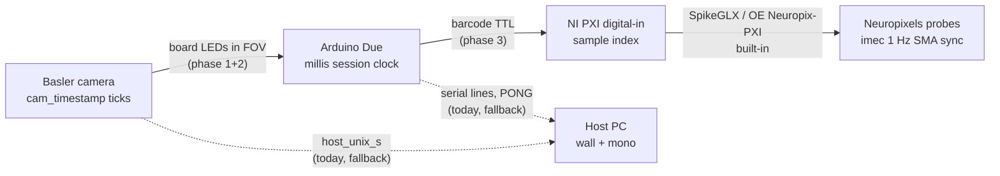
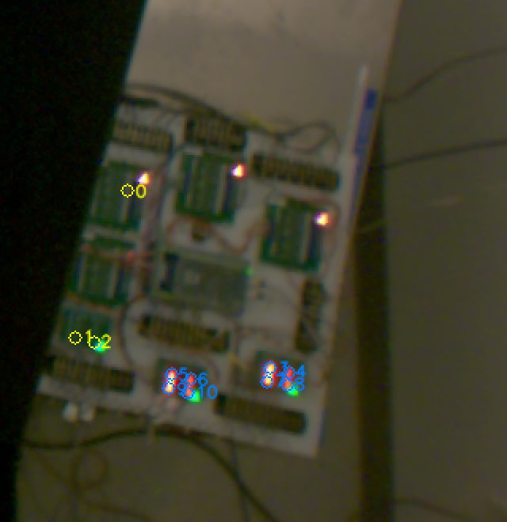
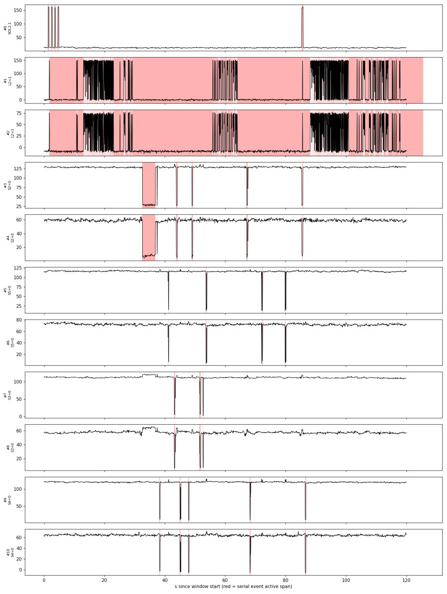
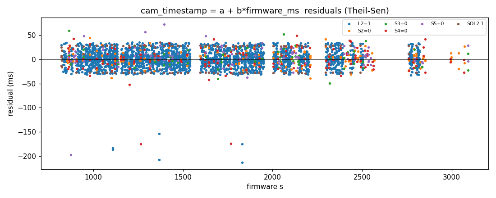

# Design: synchronizing the video, Arduino, and Neuropixels streams

- **Author / Agent:** Agent (Cursor) on behalf of Celine
- **Date:** 2026-09-02
- **Status:** Proposal, **Phase 1 feasibility confirmed** on real footage
  (§3.7, 2026-09-04); later ADRs will cite it
- **Scope:** How the three data streams a session produces — the overhead
  **video**, the **Arduino** event stream (beams, licks, rewards, cues), and the
  future **Neuropixels** recording — get put on one shared time axis, precisely
  enough that a spike, a video frame, and a beam break can be compared. It covers
  (1) reading the indicator LEDs already on the rig's electronics board out of the
  video, (2) adding two cue LEDs, and (3) a later dedicated pseudorandom sync line.

This is a design proposal, not an implementation. It states what exists today,
the target, a staged path, and the open questions to settle on the bench. It is
written for a lab with mixed coding backgrounds; technical terms are glossed on
first use and also live in [`docs/glossary.md`](../glossary.md). The companion
backlog entries are FW-0045 (board-LED detection), FW-0056 (cue LEDs), and
FW-0018 (dedicated sync line) in [`docs/future-work.md`](../future-work.md).

---

## 0. TL;DR

- **Today, alignment is "trust the PC's clock".** Trial events are stamped with the
  host wall clock, video frames with the host wall clock, and the two are joined
  by time. That is tens-of-milliseconds accurate and carries the serial-port
  delay; the Arduino's own hardware clock is written to disk but never used. There
  is no link at all to a neural recording yet.
- **The electronics board next to the maze is already a sync device.** Its
  optocoupler modules carry indicator LEDs that light whenever a body sensor is
  triggered or a solenoid fires — and the board is in the camera's field of view.
  Every one of those flashes is the *same electrical edge* the Arduino
  timestamps. Reading the LEDs out of the video gives a direct video↔Arduino
  clock fit with hundreds of points per session, **with no hardware or firmware
  change** (Phase 1). **Measured on one real H.264 session (§3.7):** 11 LEDs read
  cleanly, 3,500 matched points, residual spread ±10 ms (a quarter frame), and
  the host-clock join was shown to carry a 59 ms bias plus a 27 ppm drift.
- **Two cue LEDs on spare optocoupler channels** extend that to cue onsets, which
  currently have no visible marker (Phase 2). One wire per cue from a free Due
  pin; the module's own indicator LED does the rest.
- **A pseudorandom sync line, later**, ties the Arduino to the Neuropixels
  acquisition (one TTL into the NI digital-input card) and gives a drift-proof
  fiducial that all three streams see (Phase 3).
- **Design principle:** the Arduino's millisecond clock is the hub every other
  clock is fitted to; the host clock is only a coarse bridge and a fallback.
  Whenever a link is missing the system must say so and fall back to today's
  behaviour — never produce a silent wrong fit.

A **fiducial** is a landmark visible in more than one stream at once, used to line
them up (like a clapperboard in film). A **clock fit** is the straight line
`time_in_stream_B = offset + rate * time_in_stream_A` estimated from matched
fiducials; **drift** is the slow change of that offset over a session because no
two clocks tick at exactly the same speed.

---

## 1. Where we are

### 1.1 The clocks in a session bundle

[`data-format-review.md` §2.2](data-format-review.md) lists five time-bases.
The ones that matter here:

| Clock | Where | What it is | Used for alignment today? |
|---|---|---|---|
| `session_t0_*` | manifest, CSV headers, sidecar header | The canonical session zero: host wall + monotonic + ISO at Start Session (ADR-0124) | Yes — the anchor |
| `*_iso` columns | trial / excursion CSV | Host wall clock at the moment the host *decided* to act (includes ~ms serial delay) | Yes — joined to `host_unix_s` |
| `host_unix_s` | video sidecar, per frame | Host wall clock (`time.time()`) at frame grab | Yes |
| `cam_timestamp` | video sidecar, per frame | The Basler camera's **own hardware clock**, in ticks, at exposure | **No** (written every frame; blank if the driver gives none) |
| firmware `<ms>` | serial log (`serial/`), `lick_fw_ms`, `rig_ms` | Arduino `millis()` since session start; **resets on a MODE switch** (ADR-0064) | **No** (write-only) |

The analysis repo (`drieu_lab_analysis`) aligns trials to frames by converting
`*_iso` to epoch seconds and slicing the sidecar on `host_unix_s`; it does not
read the serial log at all. The `#260720_DataVideoSync` entry in
[`docs/notes/Bugs.md`](../notes/Bugs.md) asks whether this is actually correct —
nobody has measured it.

### 1.2 What the Arduino already emits

- Four **5 ms TTL pulses** intended for a neural-acquisition digital input:
  choice, return-arm, tone-on, tone-off on Due pins 4–7
  (`firmware/common/rig_config.h`, `PIN_TTL_*`; ADR-0044, ADR-0063). None of them
  is wired to anything yet (`CONFIRM wired`).
- **No** reward TTL, no periodic sync pulse, no barcode, no camera trigger.
- A `PING`→`PONG` at Start Session, giving one point where host wall time and
  firmware ms are written together (ADR-0048, ADR-0124).

### 1.3 Camera facts that shape the design (verified in `ui/camera_view.py`)

- The GUI's default format is **lossless FFV1** (`RECORD_FORMATS[0]`), but in
  practice operators pick **H.264** (CRF 18): 43 of the 48 session videos on the
  rig PC are `.mp4`, including every recent one. So H.264 is the case that
  matters, and the feasibility spike (§3.7) was run on it: the LEDs survive the
  compression with a contrast of 90–180 grey levels against a noise floor of ~25,
  so no lossless fallback is needed.
- Frames are **undistorted at the source** (ADR-0015; `_maybe_undistort` on the
  grab thread), so preview, tracking, and the saved video share the corrected
  geometry. Any LED regions we define live in that corrected image space, and
  the sidecar header records whether undistortion was on.
- `cam_timestamp` is `grab.TimeStamp` cast to int, written every frame, blank if
  unavailable. Its tick rate was **measured at 1.0000 GHz** (ticks vs
  `host_unix_s` over a 39-minute session, §3.7), i.e. the value is nanoseconds
  on the camera's own clock; it was present on every one of that session's
  58,231 frames.
- **Exposure and gain are left at the camera's power-up defaults**; no `.pfs` is
  loaded unless the operator picks one. If the camera auto-exposes, a blinking LED
  bank at the frame edge could nudge exposure and make thresholds unstable.
- The camera runs **free** at roughly 25–42 fps (no hardware trigger; ADR-0011).
  A 5 ms TTL pulse is therefore invisible to the camera; only events that last
  longer than a frame period (a beam break, a 300 ms reward pulse, a whole tone)
  can be seen.

### 1.4 The electronics board (from the rig photo and `generate_rig_manual.py`)

The board sits on the wall to the right of the maze, inside the camera's field of
view but at the **far edge of the frame** (where lens distortion is strongest
and pixels-per-cm is lowest). It carries the Arduino Due, OPI104-HS optocoupler
breakouts (Due → 24 V solenoid drivers) and MT-301R4P-N 4-channel
optocoupler / level-shifter modules (12 V Banner sensors → 3.3 V Due). Each
module channel has an indicator LED (red in the photo) that lights when its
input is active; a steady green power LED is also visible. **Nothing lights for a
cue** — the cue is an analog waveform on DAC0, not a digital line.

---

## 2. Target: the clock chain

The Arduino is the hub. Every other stream is fitted *to* the Arduino's
millisecond clock through a hardware link, and the host clock is kept only as a
coarse bridge and the fallback.

Why this shape:

- **Camera ↔ Arduino via LEDs** costs nothing new for sensors and rewards (Phase 1)
  and two wires for cues (Phase 2). The LEDs are self-illuminating landmarks in a
  dim room, which also makes them ideal for finding the board in the image.
- **Arduino ↔ NI via one TTL barcode** (Phase 3). Neuropixels acquisition over PXI
  (SpikeGLX, or Open Ephys with the Neuropix-PXI plugin) already synchronizes the
  probes to the NI digital card using the imec basestation's 1 Hz SMA sync
  square wave. So the Arduino only has to reach **one NI digital-input line**;
  probe↔NI is handled by the acquisition software.
- **Host stays a bridge.** `host_unix_s` and `*_iso` still give the coarse first
  guess that makes matching fiducials unambiguous, and they remain the alignment
  when no hardware link is present.

### Precision targets

| Link | Target | How it is met |
|---|---|---|
| video ↔ Arduino | within one frame period (~25–40 ms), with the *sub-frame* mean offset estimated from many events | LED edges (Phase 1/2), robust linear fit |
| Arduino ↔ NI (probes) | sub-millisecond | barcode TTL decoded at the NI sample rate (Phase 3) |
| drift over a > 1 h session | bounded by the fit's rate term; verified by residuals over time | continuous events (Phase 1) or periodic barcodes (Phase 3) |
| any link missing | loud verdict + fallback to today's host-t0 join | every phase |

---

## 3. Phase 1 — read the existing board LEDs (no hardware or firmware change)

**Goal.** From a recorded session (video + sidecar + serial log), recover for each
board LED the frames where it turned on/off, match those edges to the
corresponding serial events, and fit `cam_timestamp ↔ firmware ms`.

### 3.1 LED inventory (to be filled on the rig)

A one-time table, kept in the new `host/led_map.json` (below). One row per
indicator LED:

| Field | Meaning |
|---|---|
| `led_id` | short stable name, e.g. `beam_entry`, `sol_center_r2`, `power` |
| `module`, `channel` | which physical module / channel the LED belongs to |
| `colour` | `red` / `green` / … (drives the colour-channel trick below) |
| `event` | the serial event it mirrors: `S,<beam>` edge for a sensor, `SOL,<port>,<idx>` / `REWARD` for a solenoid, `CUE,ON/OFF,<band>` for a cue LED (Phase 2), `always_on` for the power LED |
| `polarity` | whether the LED is lit when the beam is *broken* or *intact* (unknown until measured; the correlation sign settles it) |
| `board_xy` | position in a flat "board frame" (any consistent unit, e.g. mm from a corner) — the **constellation** |
| `ref_px` | pixel centroid in the reference image, when the map was made |

### 3.2 Detection (per LED, per frame)

- A small **region of interest (ROI)** around each LED, derived from the
  registered constellation (§3.4), not hard-coded pixels.
- Brightness measured **relative to a local background ring** around the ROI, so
  room-light changes and exposure wobble do not create false edges.
- For red LEDs use **red minus green** rather than grey; it separates an LED from a
  reflection far better on a colour camera.
- **Hysteresis** (turn on above one threshold, off below a lower one) plus a
  minimum on-duration of one frame, to avoid chatter.
- Output per frame: on/off per LED; per session: a list of rising and falling
  edge frames per LED with their `cam_timestamp`, `host_unix_s`, and `frame_idx`.

### 3.3 Mapping LEDs to events (once, then verified every session)

The mapping *could* be typed in by hand from the wiring, but the wiring labels
have already been wrong once (see the beam-name aliases in `rig_config.h`). So:

1. **Mapping session.** With no rat, run `tmaze_test` and the camera: fire each
   solenoid a few times, break each beam by hand a few times, play each cue.
   The serial log then contains a clean, sparse event train per event type.
   (The spike in §3.7 showed a normal training session binds every visible LED
   on its own, so the dedicated session is mainly for LEDs that a rat's session
   never fires — left/right reward, rinse/drain, the Phase 2 cue LEDs.)
2. **Cross-correlate.** For every blinking blob found in the video (§3.4) and
   every event type in the serial log, cross-correlate the blob's on/off trace
   with the event train over a coarse window (the host-clock join gives the
   starting alignment within ~100 ms). The pair with the dominant peak is the
   binding; the peak position is the lag; a negative peak flips `polarity`.
3. **Write `led_map.json`.** Bindings, polarities, constellation, reference
   pixel positions, and a small reference crop of the board.

Every subsequent session repeats step 2 *passively* on its own events (the rat
breaks every beam dozens of times; rinse/drain fire at every trial start per
ADR-0010; the reward valve fires every rewarded trial) and reports a per-LED
verdict: **`matched`** (clear peak at a plausible lag), **`silent`** (the ROI
never changed), **`displaced`** (a blob elsewhere correlates with that event
train — the board or camera moved). No manual beam triggering is ever required
for the check.

### 3.4 Finding the board every session: constellation registration

The board is flat and the camera is fixed, so if either moves between sessions
the LED pattern moves in the image as one rigid shape — to first order a
**similarity transform** (rotation + translation + a little scale), or a
**homography** if the board tilts. Rather than trusting stored pixel positions:

1. Build a **max-minus-median image** over the first few minutes of video (or the
   roll-call window, §4.3): every LED that blinked shows up as a bright blob;
   everything static cancels.
2. Threshold → blob centroids → the *observed* point set.
3. Match it to the stored `board_xy` constellation (Procrustes with RANSAC for a
   similarity; a 4-point homography if needed; with 10–15 points brute force is
   fine) and derive every ROI from the fitted transform.
4. **Break the grid ambiguity with time.** Each MT-301R4P-N has four identical
   channel LEDs in a row, so a shift by one channel pitch looks geometrically
   like no shift. The Arduino-driven LEDs (cue LEDs, rinse/drain, later the sync
   LED) blink at *known* times and label their blobs unambiguously; the always-lit
   green power LED is a landmark even before anything fires. Geometry places the
   rest.
5. Report the fitted transform and its residual; a large residual or too few
   blobs is a **loud** `registration_failed` verdict, and the pipeline falls back
   to the host-t0 join for that session.

This makes retroreflective markers unnecessary: the LEDs are active landmarks and
the room is dark. Markers remain a fallback if a future board has too few LEDs
to register. A secondary cue — template/phase correlation of the reference board
crop against the current frame — can estimate translation before any LED fires,
but under the rig's lighting it is a check, not the primary method.

### 3.5 The clock fit

For each LED with verdict `matched`, pair each detected edge with its serial
event (nearest in host time, then refined by the mapping lag). Each pair is a
point (`firmware_ms`, `cam_timestamp`). Then:

- Fit a **robust straight line** (e.g. Theil–Sen or RANSAC least squares) per
  **MODE segment** — the firmware clock restarts on every `MODE` switch
  (ADR-0064), so each segment gets its own offset, sharing the rate.
- Report **residuals**: their spread is the camera-exposure + detection jitter;
  their mean per event type is the systematic delay between the electrical edge
  and the visible flash (expected: microseconds for the optocoupler, plus the
  Arduino's 5 ms sensor debounce, plus up to one frame of exposure). Residual
  trend over time is drift the rate term did not absorb.
- Bridge to the host clocks via the sidecar's `host_unix_s` on the same frames;
  the difference between the LED-based fit and the current `*_iso` join **is the
  measured answer** to `#260720_DataVideoSync`.

### 3.6 Outputs and where the code lives

Agreed home: the **rig repo**, so the bundle carries the fitted alignment and the
analysis repo only reads it (keeping the bundle the single contract,
ADR-0142/0143).

| Artifact | Path in the bundle | Content |
|---|---|---|
| LED events | `sync/led_events_<id>.csv` | one row per detected edge: `led_id, edge, frame_idx, cam_timestamp, host_unix_s, matched_event, firmware_ms, residual_ms` |
| Clock fit | `sync/clock_fit_<id>.json` | per-segment `offset`, `rate`, residual stats, per-LED verdicts, registration transform + residual, `method: led-fit`, versions |
| Config snapshot | `config/led_map.json` | copied at Start Session via `session_config.HOST_CONFIG_FILES` like `zones.json` (ADR-0072) |

Manifest: register `sync_led_events` / `sync_clock_fit` via
`SessionManifest.set_stream`, and let `fiducial.method` take the value `led-fit`
(today `host-t0`). `format.json` should list the new stream and its columns.

Code map (respecting the pure-core / thin-shell rule in
[`CONTRIBUTING.md`](../../CONTRIBUTING.md)):

- `tmaze/vision/led_detector.py` — ROI brightness, hysteresis, edge extraction
  (OpenCV/NumPy, no Tk).
- `tmaze/core/sync/` — spans, event matching, robust fit, verdicts (stdlib only,
  per the core purity rule; headless-tested with synthetic traces and a real
  excerpt — landed in Slice 1, see the end of §3.7). Constellation registration
  needs pixels and joins `led_detector` in the vision layer.
- `tmaze/tools/sync_fit.py` — the offline runnable, modelled on
  `maze_state_validate.py`: reads a bundle, writes the two `sync/` artifacts,
  prints a report; `--selftest` on synthetic data; `--map` mode that builds
  `led_map.json` from a mapping session.
- Later: a live **preflight** in `camera_view` (§4.3). There is no generic
  per-frame detector hook today — tracking is dispatched to a worker through a
  `LatestFrameSlot` (ADR-0040) — so a second slot + worker, or a subscriber on the
  grab thread, would be needed. Offline first; live is an add-on.

The analysis repo reads `clock_fit` and applies it when converting `firmware_ms`
or `cam_timestamp` to the session axis; nothing else there changes.

### 3.7 Feasibility findings (Slice 0 spike, 2026-09-04)

Before writing production code, the question "can the LEDs actually be read out
of the H.264 video?" was put to a real session with a throwaway tool,
`python -m tmaze.tools.led_sync_prototype` (kept in the repo as an exploratory
runnable, like `blob_tracker_prototype`; see `PROGRAMS.md`). Session
`600_20260903_134552`: rat 600, 39 min, H.264 at CRF 18, 24.96 fps, 58,231
frames, undistorted, `cam_timestamp` on every frame. Board crop
`x 800–1120, y 470–800` in the recorded frame.

**Verdict: go.** Every number below was measured on that session; the full
39-minute run took 5.7 min on the rig PC (two sequential decode passes).

- **Detection on H.264 is not marginal.** Eleven blinking blobs were found as
  local maxima of the max-minus-median (LEDs that light up) and median-minus-min
  (LEDs that go dark) images. Their contrast is 90–185 grey levels (0–255) against
  a compression noise floor of ~25 in those extreme images, so a blob threshold of
  30–35 separates them cleanly; 15 finds a thousand false blobs. A 2 px-radius
  disk minus a background ring (3–7 px) gives per-frame traces that swing from
  ~60–130 down to ~0 on a beam break, with no visible smear.
- **Neighbouring LEDs need peak detection, not connected components.** Each
  MT-301R4P-N channel shows **two** LEDs ~12 px apart (input and output side of
  the optocoupler), and channels are stacked ~8 px apart vertically. Connected
  components with dilation merged them; non-maximum suppression over a 7 px
  window separates them.
- **Blob positions are stable** across the first 6 min, minutes 8–16, and the full
  session (within 0.1 px), so ROIs derived once per session are sound.

**Bootstrapped bindings.** No mapping session was needed: the rat's own events
bind every blob. The match is by *interval* — the LED's dark (or lit) span must
agree with the serial event's span at **both ends** within ±150 ms — which is what
separates beams the rat crosses within a few hundred ms of each other (a
nearest-edge match confused ENTRY/EXIT and gave 80–170 ms spreads). Recall is
counted only against serial spans ≥ 60 ms, because a 40 ms frame cannot register
a 15 ms flicker. Pixel positions are in the crop; add (800, 470) for full-frame.

| Blob | Crop px (x, y) | Binds to | LED state during event | Matched / visible events | LED spans | Start lag (median ± MAD) | F1 |
|---|---|---|---|---|---|---|---|
| 0 | (80, 120) | `SOL,2,1` (centre reward, 300 ms) | lit | 54 / 56 | 56 | +32 ± 2 ms | 0.96 |
| 1, 2 | (47, 213), (59, 216) | `L,2` lick detector (`L,2,1` span) | dark | 1385 / 3115, 1451 / 3115 | 1397, 1463 | +69 ± 9 ms | 0.61, 0.63 |
| 3, 4 | (170, 232), (182, 235) | beam `S,2` — `S,2,0` span | dark | 73 / 86, 74 / 86 | 79, 79 | +65 ± 11 ms | 0.88, 0.90 |
| 7, 8 | (168, 241), (181, 243) | beam `S,3` — `S,3,0` span | dark | 41 / 46, 40 / 46 | 45, 44 | +68 ± 13 ms | 0.90, 0.89 |
| 5, 6 | (108, 236), (120, 239) | beam `S,5` — `S,5,0` span | dark | 46 / 58, 49 / 58 | 49, 50 | +69 ± 10 ms | 0.86, 0.91 |
| 9, 10 | (106, 245), (118, 248) | beam `S,4` — `S,4,0` span | dark | 74 / 99, 77 / 99 | 78, 78 | +62 ± 9 ms | 0.84, 0.87 |

Precision is 93–99 % everywhere (nearly every LED span the video shows is a real
serial event); the lick pair's lower F1 is recall on very short lick spans, not
false detections. Beams `S,0` and `S,1` (ENTRY/EXIT, 175 and 239 crossings) have
**no visible blinking LED** in the crop — their channel LEDs are hidden by wiring
or face away; to be checked on the rig. Only the centre solenoid fired in this
session, so the other OPI104-HS LEDs (left/right reward, rinse/drain) are unbound
but detectable by the same method whenever they fire.

**Two facts about the serial log fell out of the matching:**

1. **Beam polarity is inverted relative to `PROTOCOL.md`.** The doc says
   `S,<i>,1` = broken. In the log the `1` spans reach tens of seconds (p90
   26–74 s on every beam) while the `0` spans never do (median 50–230 ms, p90
   0.2–0.4 s); the LEDs go dark during the `0` spans. So the resting state is `1` and the crossing is
   `0`, consistent with the Banner sensors running in light-operate mode (output
   on while the beam is received) behind an inverting optocoupler stage. Host
   consumers that take `active` at face value should be reviewed; the LED map
   simply records the measured polarity.
2. **Sub-frame chatter is common.** 20–45 % of beam state spans are shorter than
   one frame (median span of the `1` state on a busy beam can be ~100 ms because
   of bounce). Irrelevant for the fit — it uses only matched spans — but it
   means video-based beam recall will never approach 100 %.

**The clock fit** (Theil–Sen on 3,500 (`firmware_ms`, `cam_timestamp`) pairs,
both ends of every matched span):

- Residuals: median 0, **MAD 9.5 ms, p5–p95 = −26…+29 ms** — inside one 40 ms
  frame period, flat over 39 minutes (the rate term absorbs the drift), with
  ~10 mis-pairs at −150…−200 ms that the robust fit ignores.
- Rate: **1.000027 camera-ns per firmware-ms**, i.e. the Arduino `millis()` and
  the camera clock disagree by **27 ppm ≈ 63 ms over this session** (≈ 97 ms per
  hour). A fixed-offset join would be off by 1.5 frames at the end; the rate
  term is necessary, as §3.5 assumed.
- `cam_timestamp` tick rate: **1.0000 GHz** (ns), from its slope against
  `host_unix_s`.
- **Host-clock bridge:** the frame that first shows an LED change is stamped
  (`host_unix_s` at grab) **59 ms after** the serial line's host wall-clock
  stamp, MAD 10 ms. That is the systematic bias of today's `host-t0` join —
  roughly camera exposure + readout + GigE transfer minus serial latency — and
  is **the measured answer to `#260720_DataVideoSync`**: video ↔ Arduino
  alignment via host stamps is good to about 1.5 frames systematic and ±0.25
  frame jitter; the LED fit removes the bias.
- Onset vs offset asymmetry: LED **turn-on** lags the serial line by +32 ms
  (SOL), LED **turn-off** by +62–69 ms (beams, lick), and the SOL span's end
  lags +87 ms. The ~40 ms difference is one frame: a saturating LED that turns on
  part-way through an exposure still clears the 60 % threshold in that frame,
  while one that turns off part-way through still leaves enough light to stay
  above 40 %, so the off edge lands one frame later. The production fit should
  therefore fit **one offset per edge polarity** (or use only turn-on edges and
  the LED-lit-for-`0`-span convention), rather than one per event type.

**Consequences for Slices 1–4.** The design stands; the following refinements
are adopted from the spike:

- `core/sync` matches **intervals** (both ends), with a minimum visible span and
  the sensors' measured active states (`S<i>=0`, `L<i>=0`; see Slice 1 below);
  per-polarity edge offsets in the fit.
- `vision/led_detector` finds LEDs as **local maxima** of the extreme images,
  radius-2 disk minus ring, hysteresis at 40/60 % of the min–max span of a
  3-frame median-filtered trace (percentile-based levels miss a 1 %-duty LED).
- Blob threshold default 30–35 on the extreme images; the report should print the
  noise floor so a future CRF change is caught.
- Two-pass sequential decode is fast enough (≈ 170 fps per pass, 5.7 min for a
  39-min session); no need for a seekable index or a lossless ROI stream.
- Open items carried forward: locate the ENTRY/EXIT LEDs on the rig; confirm the
  beam and lick polarity by hand on the rig (the `PROTOCOL.md` rows were
  corrected from the logs in Slice 1; the firmware comment and consumer audit
  are FW-0058); exposure pinning (§1.3) remains advisable but was not needed here.

**Slice 1 (2026-09-08) — `tmaze/core/sync/` landed** (`spans`, `matching`,
`clockfit`, `pipeline`; stdlib-only, tested on synthetic data and on a real
five-minute excerpt of the spike session kept as a fixture). Further decisions
were taken while making the real excerpt pass, most forced by sensor chatter or
by the camera under-sampling fast channels:

- **Coalesce on the firmware clock before judging visibility.** A `0→1→0→1`
  bounce with a sub-frame `0` in the middle shows in the video as one lit span,
  so the two serial `1` spans around it are merged (gap < 60 ms) before spans
  shorter than 60 ms are dropped. Otherwise the LED's ON edge is attributed to
  the *later* `S,i,1` line and lands as a −100…−150 ms outlier. Gaps and
  durations must be measured on the firmware `ms`, not the host stamps: when
  the PC reads several lines in one batch their host stamps are only ~40 ms
  apart even when the firmware says 99 ms, and the wrong pair gets merged.
- **Sensor polarity is hard-coded, and the lick detector is inverted too.** "LED
  dark while `S4=0`" and "LED lit while `S4=1`" describe the same wire, and
  letting both compete gave two labels for one LED (an earlier draft pooled
  them, which made the reported counts and score come from different
  phrasings). Since the polarity is a fixed property of the wiring, `core/sync`
  now matches only the sensors' **active** states — `S<i>=0` (crossing) and
  `L<i>=0` (tongue contact) — via `spans.active_spans`, and a fixture test
  verifies the choice against the real log (the active state is the brief one).
  That test caught the lick detector: over the full spike session `L2=1` runs up
  to **257 s** unbroken (1582 s in total) while `L2=0` never exceeds **0.3 s**
  (median 92 ms), so `L,2,0` is the contact and `L,2,1` idle — the mirror of
  `PROTOCOL.md`'s `L` row, exactly like the beams. Both rows of `PROTOCOL.md`
  were corrected (2026-09-08); the firmware comment and the audit of host
  consumers that read the `L`/`S` `active` flag remain open under FW-0058. The
  lick LEDs then read "**lit while `L2=0`**" — the LED lights on contact — with
  the ON-edge lag (+40 ms), not the OFF-edge lag the spike table shows for the
  `L,2,1` phrasing.
- **The binding score is precision, not F1.** "Which wire is this LED on?" is
  answered by the fraction of the LED's spans that a channel explains; recall
  over the visible serial spans measures **camera coverage** and is reported
  alongside. The camera catches only ~30–45 % of licks, so F1 would have
  rejected a lick LED whose every blink is a real lick (F1 0.46 at precision
  1.0). Lick precision itself is ~0.7 rather than 1.0 because a release shorter
  than two frames is invisible to the 3-frame median filter, so one LED span
  sometimes covers two serial contacts.
- **A binding must lag its wire at both edges.** Precision alone cannot
  separate a wire from a *behaviourally coupled* channel: the centre reward
  fires as the rat crosses the centre beam, so 7 of the 8 centre-beam LED dark
  spans in the excerpt also overlap a 300 ms `SOL` pulse (precision 0.88, a
  tie). But that LED relights ~150 ms *before* the pulse ends, and an LED driven
  by a wire cannot react before the wire does. `matching.lag_plausible` requires
  the median start **and** end lags to be ≥ −20 ms (room for serial-stamp
  jitter); it also rejects the wrong-LED-polarity lick candidate (lag −37 ms).
- **Tolerance 200 ms, not 150.** The nominal worst case is ~140 ms (60 ms host
  lag + one 40 ms frame of quantisation + one more frame on OFF edges); chatter
  merged into a crossing can put its serial start a further 50–70 ms before the
  LED visibly reacts, and at 150 ms those spans were rejected (a beam LED fell
  to 4 of 8). 200 ms stays under the ~170 ms lick-burst period, so neighbouring
  licks cannot pair at both ends. Cost: the fit's p5–p95 residual spread on the
  excerpt widens from ~90 to ~110 ms (MAD 25 ms) as a few chatter-shifted edges
  enter; Theil–Sen is unmoved.
- Licks are **bound and reported but excluded from the fit by default**
  (`pipeline.DEFAULT_FIT_CHANNEL_KINDS = ("S", "SOL")`): beams + valve already
  give thousands of unambiguous points per session and licks were the one source
  of mis-pairs; opt in per call.
- Ordering is enforced: the matcher is an ordered, one-to-one longest chain
  within the host-clock band (the localized piece of sequence alignment, §3.3),
  and the fit checks the host lag for steps between blocks of pairs
  (`host_clock_step` verdict).

Raw outputs (figures, `bindings.csv`, `summary.json`) are regenerated by the
prototype; the three figures above are the only copies kept in the repo.

#### Slice 2 (2026-09-09) — `tmaze/vision/led_detector.py` + `led_map.json` landed

The pixel side of §3.2/3.4 is now a module rather than the prototype's script
body: `Extremes` → `detect_blobs` (local maxima of the two difference images,
merged, numbered top-to-bottom, with the compression `noise_floor` reported) →
`TraceSampler` (disk-minus-ring, grey and red-minus-green) → `blob_spans` (the
core's hysteresis), plus `register` for the constellation and the schema of
`host/led_map.json` in `core/sync/led_map.py` (stdlib, so the core can read
it). Tests: synthetic frames rendered in `tests/test_led_detector.py`, and a
real 60-second board clip in `tests/test_led_detector_clip.py`. Decisions taken
with the user before starting (2026-09-09):

- **Board coordinates are reference-image pixels.** `board_xy` in §3.1 collapses
  into `ref_px`: the constellation is the set of LED centroids in the session the
  map was made from, and every later session is a similarity transform relative
  to that reference. No ruler on the rig; a physical board frame would add a
  measurement step for no gain while the camera is fixed.
- **The detector searches a stored rectangle, not the whole frame.** A
  max-minus-median over the full frame also lights up wherever the rat moved.
  `led_map.json` carries a `board_rect` (full-frame px) seeded by the mapping run
  from the LEDs it found plus a margin (`DetectorParams.margin_px`, 24 px);
  registration tracks shifts inside it. Nothing is drawn by hand. The whole-frame
  search stays available for the no-rat mapping session, where it is trivially
  clean.
- **Registration is brute force over correspondence pairs.** With ~11 LEDs,
  every pair of reference points against every ordered pair of observed points
  (~6,000 hypotheses) is instant, needs no RANSAC bookkeeping, and is exhaustive.
  The best hypothesis by inlier count is refined by least squares (2-D
  Procrustes) on its inliers; rotation is capped at ±20° and scale to 0.8–1.25
  since the board does not turn over between sessions. **Ties are reported, not
  guessed**: when several *distinct* transforms explain the same number of
  points (a row of four identical channel LEDs with one silent looks the same
  shifted by one pitch) the verdict is `ambiguous`, the smallest shift is
  returned and the alternatives listed — the bindings' time labels break the tie
  in Slice 3, as §3.4 step 4 intended. Too few inliers or an RMS above the 2 px
  tolerance is `registration_failed`.
- **Offline only for now.** Two decode passes at ~170 fps (5.7 min for a
  40-minute session on the rig PC); live per-LED sampling into the sidecar is
  deferred to the preflight phase (§4.3).
- **The real fixture is a 60-second board crop.** At the rig's CRF 18 the noisy
  board region costs ~34 KB/s to re-encode (10 MB for five minutes), so the clip
  is the densest minute of the five-minute JSON excerpt (frames 12305–13804,
  every LED blinks ≥ 2× each way) at libx264 CRF 22: **649 KB** plus a 56 KB
  sidecar excerpt. CRF 22 lifts the noise floor from the spike's ~25 to ~30 —
  right at the default blob threshold — and the detector still finds the 11
  LEDs and no false blob, so the fixture is a slightly harsher test than
  production. The clip reproduces 242 of the 243 JSON-fixture spans that fall in
  its window within ±1 frame, registers against the fixture's positions with
  0.14 px RMS, and binds every LED to its channel from that one minute.

Open from this slice: the ENTRY/EXIT beams `S,0`/`S,1` still have no visible
LED in the board crop (to be checked on the rig); the `--map` mode and the
`sync/` artifacts are Slice 3.

#### Slice 3 (2026-09-09) — `tmaze/tools/sync_fit.py` landed

The offline runnable of §3.6, a thin shell over `led_detector` + `core/sync`:
detect the board LEDs on a bundle, bind each to its serial channel, fit the two
clocks, and **write `sync/led_events_<id>.csv` + `sync/clock_fit_<id>.json` into
the bundle**. `--map` builds `host/led_map.json`; `--dry-run --out` prints the
report and writes the artifacts to a scratch folder instead; `--selftest` checks
the core end to end with no video. Tested in `tests/test_sync_fit.py` (pure
builders on synthetic spans + an end-to-end run over the committed board clip).
Decisions taken with the user (2026-09-09):

- **Default writes into the bundle.** The fitted alignment belongs with the data
  it describes (the bundle is the single contract, ADR-0142/0143), so the plain
  `sync_fit <bundle>` writes the two `sync/` files there; `--dry-run` is the
  safe rehearsal. The tool is idempotent — re-running overwrites its own two
  files and nothing else.
- **No map → bootstrap and warn.** Until a mapping session exists most bundles
  have no `led_map.json`. Rather than refuse, the default run bootstraps the
  bindings from the session itself (as the spike did) and prints a warning
  suggesting `--map`; when a map *is* present it registers the constellation and
  names/verifies each LED against it. Same code path, the map just adds names +
  a registration verdict.
- **`--map` is for a no-rat mapping session; `--board-rect` rescues a rat
  session.** Building a map whole-frame is only clean with no rat: on a real
  training session the rat's motion lights up the whole maze in max-minus-median
  (564 blobs on the spike session, 77 of them binding — a blob where the rat
  sits at a beam both brightens *and* coincides with that beam breaking, at a
  plausible lag). So `--map` searches the whole frame by default (the mapping
  session), and an optional `--board-rect X0 Y0 X1 Y1` confines the search to the
  board — which both makes `--map` usable on a rat session and is the fast path
  (the cropped decode) before any map exists. With the spike's board rectangle,
  `--map` on the rat session recovered exactly the 11 board LEDs, all bound,
  matching §3.7.
- **Manifest/format left for Slice 4.** `sync_fit` drops the two files in `sync/`
  but does not yet announce them in `session.json` / `format.json` or flip
  `fiducial.method` to `led-fit`. That is a data-contract change (an offline tool
  rewriting the manifest the rig wrote, plus a `format_version` bump) and lands
  with its ADR in the integrate slice, so a reader that trusts only the manifest
  won't act on the fit until then.
- **`--min-matched` / `--min-pairs` are exposed.** The binding/fit thresholds are
  tuned for a full session (thousands of crossings); a short window or a quick
  look needs lower values, so both are flags (defaults 3 / 30). The clock-fit
  `--tol-ms` defaults to the measured 200 ms (§3.7).

The `led_events` residual per row is `(cam_ticks − fit.predict(firmware_ms)) /
rate`, i.e. firmware-ms of misalignment for that edge — the per-edge view of the
same residual the fit summarises.

---

## 4. Phase 2 — cue LEDs on spare optocoupler channels

### 4.1 Hardware

The cheapest camera-visible cue marker is a **spare channel on an existing
MT-301R4P-N module**: wire a free Due pin to the channel's input, and the
module's own indicator LED becomes the marker. The channel's isolated output is
left unused (or becomes a spare TTL later). One channel per cue *tone*.

Install checklist (hardware; recorded in the rig manual when done):

1. Count spare MT-301R4P-N channels; need two (three if a return-cue LED is
   wanted). If none are spare, an OPI104-HS breakout works the same way.
2. Confirm the module's **input side accepts 3.3 V logic** (the Due is 3.3 V and
   its pins source only a few mA — do not drive a bare LED from a pin). The
   module's input LED + series resistor is exactly the load the Due can handle.
3. Confirm the module input polarity (active-high vs active-low) and wire the
   common ground.
4. Proposed pins (unused today; pins 0–1 are the console UART, 4–7 the TTLs):
   `PIN_LED_CUE_LOW = 8`, `PIN_LED_CUE_HIGH = 9`, optional
   `PIN_LED_CUE_RETURN = 10`. Add to `rig_config.h` and the rig manual's pin table
   (which also still lacks TTL pins 4–7).
5. Photograph, then add the two LEDs to `led_map.json` (`event: CUE,ON,low` /
   `CUE,ON,high`) and re-run the mapping session.

### 4.2 Firmware

- The LED must be a **level held for the whole tone**, not a 5 ms pulse, or the
  camera will not see it.
- Cue identity in the firmware is a **frequency**, not a side: `handleCueOn()`
  (`cue-guided-task.ino`) resolves `freq` from the trial's correct arm, the
  return-cue coin flip, or a host-supplied Hz (ADR-0046). Pick the LED by which
  band `freq` falls in — nearer `cfg.lowToneHz` or `cfg.highToneHz` (midpoint
  split) — so the LEDs mean "low tone" / "high tone", the only identity the
  firmware reliably has. (Alternative, if ever needed: an explicit LED index
  field on `CUE_ON`.)
- Set the pin HIGH in `handleCueOn()` right where `startToneAsync()` is called
  (the cue kind and `freq` are known there; `startToneAsync` itself only sees
  a frequency), and LOW in `handleCueOff()` next to `stopToneAsync()`. Also
  clear both pins in the MODE-reset path so a mode switch mid-tone cannot leave
  an LED stuck on.
- **Optional `LEDTEST` command** for the roll-call (§4.3): `LEDTEST,<mask>,<ms>`
  drives the cue-LED pins (and any future sync LED) *without* the DAC, and echoes
  `<ms>,LEDTEST,<mask>` so the serial log carries it and it can never be mistaken
  for a real cue. This is a protocol change: update `firmware/PROTOCOL.md`, bump
  `PROTO_VERSION`, and teach `tmaze.core.protocol` the new line type.

### 4.3 Session-start roll-call (preflight)

A two-second active check before the rat goes in, using only LEDs that can be
fired **without side effects**: the cue LEDs (via `LEDTEST`, silently), the
rinse/drain solenoids (they fire at every trial start anyway and dispense
nothing to the rat), and later the sync LED. **Never the reward valve, and no
manual beam triggering** — the passive check (§3.3) covers beams within the
first trials. The roll-call gives the experimenter a live "all Arduino-driven
LEDs visible, board where expected" verdict and gives the registration (§3.4)
its time-labelled anchor blobs before the rat produces any events.

---

## 5. Phase 3 — a dedicated pseudorandom sync line (later)

**Goal.** One fiducial that every stream sees, independent of behaviour, at a
known cadence, so the fit is drift-proof even in a quiet session and extends to
the neural recording.

- **Electrical.** One Due pin emits a **barcode**: a pseudorandom on/off pattern
  encoding a sequence number, repeated every N seconds. It goes (a) into one
  **NI digital-input line** on the PXI chassis (3.3 V TTL is within NI's TTL
  thresholds; confirm the card), and (b) is echoed on serial as
  `<ms>,SYNC,<seq>` (ADR-0002: only a firmware re-emit reaches every logger).
- **Two rates, one sequence.** The standard Allen / Open Ephys barcode (32 bits,
  10 ms per bit, every 30 s) is ideal for the NI card and has existing decoders,
  but it is invisible at ~30 fps. So drive a **second Due pin → a spare
  optocoupler channel LED** with a **slow** pattern: bits of ≥ 3 frame periods
  (e.g. 100 ms), an 8-bit code every ~10 s. Both patterns come from the same PRNG
  sequence number, so a decoded camera code and a decoded NI code name the same
  `seq`. The simpler alternative — one slow pattern feeding both NI and LED — is
  acceptable if the ~100 ms bit period still gives sub-ms edges on NI (it does;
  the edge timing, not the bit period, sets precision). Decide on the bench.
- **Fit.** Decode barcodes on NI → (`firmware_ms`, `ni_sample`) pairs → robust
  line. Combine with the Phase 1/2 camera fit to place video frames on the probe
  axis. Report all three residual sets.
- **Roll-call and registration** gain a guaranteed, behaviour-independent
  time-labelled LED.

This is FW-0018, retargeted from the Open Ephys acquisition-board I/O to
Neuropixels PXI / NI digital-in.

---

## 6. Risks and open questions

| Risk / question | Mitigation or how to settle it |
|---|---|
| LEDs are only a few pixels at the frame edge | **Settled (§3.7):** a 2 px-radius disk minus a background ring gives 90–180 grey levels of contrast on real footage; no lens or mirror change needed |
| H.264 smears small LEDs | **Settled (§3.7):** at CRF 18 the LEDs are clean; the compression noise floor in a max-minus-median image is ~25 grey levels, so the blob threshold must stay above ~30. Re-check if a higher CRF is ever used |
| Auto-exposure reacts to the LED bank | Pin exposure/gain with a `.pfs` loaded at start; the local-background-ring measure also desensitizes thresholds |
| `cam_timestamp` tick rate unknown / blank frames | **Settled (§3.7):** 1.0000 GHz, present on every frame of the spike session. Keep the `host_unix_s` fallback for blank ticks anyway |
| Beam polarity in the serial log is the opposite of `PROTOCOL.md` | **Found (§3.7):** the resting state of every beam is `S,<i>,1`; the crossing is the `0` span. Verify on the rig by hand, then either fix the label in `PROTOCOL.md`/firmware or make consumers polarity-agnostic (tracked as FW-0058). The LED map records the measured polarity either way |
| Sub-frame sensor spans | 20–45 % of the beam state spans are shorter than one 40 ms frame (chatter, tail flicks). The camera cannot see them; recall is measured only against spans ≥ 60 ms, and the fit never needs them |
| Grid self-similarity mis-registers by one channel | Time-labelled anchors (§3.4 step 4); refuse to fit if no anchor blob is present |
| Firmware clock resets on MODE | Per-segment offsets (§3.5); segment boundaries from the serial log's `MODE` lines |
| Long-session drift | Rate term + residual-vs-time check; Phase 3 barcodes if Phase 1 events are too sparse |
| LEDs confuse the rat tracker | Board is outside the tracker's ROI polygon; verify once on the rig |
| Rolling-shutter smear across the board | acA1300-60gc is believed global-shutter; confirm in the datasheet, otherwise widen the minimum on-duration |
| Spare optocoupler channels do not exist / are not 3.3 V compatible | Checklist §4.1 items 1–2; OPI104-HS as the fallback |
| Which NI card / line, and SpikeGLX vs Open Ephys | Decide with the ephys setup; both consume a plain TTL and both have barcode decoders |

---

## 7. Bench validation plan

1. **Electrical ↔ optical co-occurrence.** Scope one optocoupler channel input
   and point the camera at its LED; the LED-on frame must be the first frame
   whose exposure overlaps the edge. Establishes the expected residual.
2. **Mapping-session recovery.** Run the §3.3 mapping session; the tool must
   recover every binding and polarity with no ambiguity and write `led_map.json`.
3. **Fit quality on a real training session.** Residual spread < 1 frame period;
   no residual trend > 1 frame over the session; per-LED verdicts all `matched`.
4. **Displacement test.** Nudge the camera (or a mock board) by a few pixels and
   a few degrees; registration must recover the transform and every LED must
   still be `matched`. Then hide the anchors and confirm the tool *refuses*
   rather than guessing.
5. **Fallback regression.** A session with the detector off, or with no LEDs in
   view, must produce exactly today's bundle plus a clear `registration_failed`
   / `no-led` note; analysis must still run on the host-t0 join.
6. **Phase 2:** cue LED on/off frames align with the `CUE,ON/OFF` serial lines
   within a frame; `LEDTEST` echoes appear and are never counted as cues.
7. **Phase 3:** the same `seq` decodes from NI and from the camera; the three
   fits agree; the Arduino↔NI residual is sub-millisecond.

---

## 8. Staged rollout and decision records

| Step | Change | ADR? |
|---|---|---|
| 1a | `led_detector` + `core/sync` registration/fit + `tools/sync_fit` (offline), `led_map.json`, `sync/` stream + manifest/format registration | Yes — detector, bundle schema, and alignment method |
| 1b | Pin camera exposure via a default `.pfs` (tick rate already measured, §3.7) | Small ADR or note in 1a |
| 2a | Hardware: cue LEDs on spare channels; rig manual + pin table (incl. TTL 4–7) | No (hardware; documented in the resources repo) |
| 2b | Firmware cue-LED pins + optional `LEDTEST`; `PROTOCOL.md`, `PROTO_VERSION` | Yes — protocol change |
| 2c | Live preflight / roll-call in `camera_view` | Yes if it adds a second frame worker |
| 3 | Barcode sync line to NI + LED, `SYNC` echo, NI decoder, combined fit | Yes — the cross-stream sync mechanism |

Each step is independently shippable and reviewable; 1a alone already answers
`#260720_DataVideoSync` with a number.
