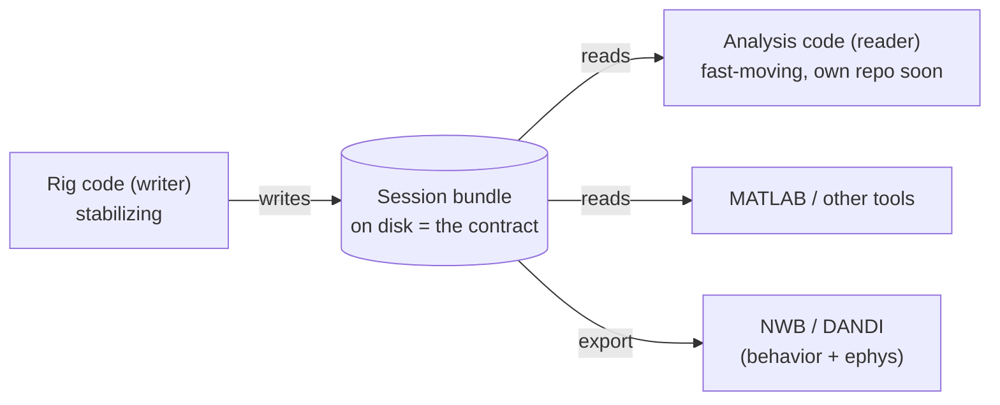
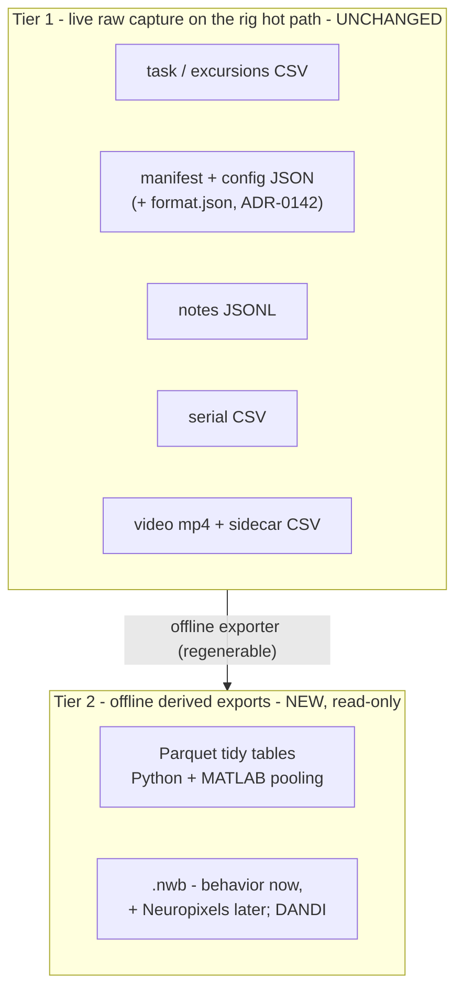

# Design review: the session-bundle data format

- **Author / Agent:** Agent (Cursor) on behalf of Ravi
- **Date:** 2026-08-30
- **Status:** Review + recommendation (no live-code changes in this document)
- **Scope:** How the rig saves one session on disk (the "session bundle"), judged
  as the *contract* between the rig (which writes it) and the offline analysis
  (which reads it) — now that the two are being versioned separately and analysis
  will move to its own repository.

This is a written review, not a rewrite. It inventories what we save today, grades
it honestly, weighs the realistic alternatives, and recommends a concrete target
plus a safe, staged path to get there. It is written for a lab with mixed coding
backgrounds; technical terms are glossed on first use and also live in
[`docs/glossary.md`](../glossary.md).

---

## 0. TL;DR

- **The bundle is in good shape and just got much better.** A commit landed today
  (ADR-0142) that makes each session *self-describing*: it writes a small
  `config/format.json` "label" and gives the analysis code version checks so it
  fails loudly instead of silently misreading a future format. That closes the
  biggest gap the first draft of this review was going to flag.
- **Keep the live capture exactly as it is.** The rig writes plain text files
  (CSV/JSON) while an animal is on the maze. That is the right choice for safety:
  text files are append-friendly and crash-resistant, and the code already writes
  them atomically (see "atomic write" below). Do not put heavy or fancy formats on
  the live path.
- **Add a second, offline tier for analysis and sharing.** Convert a finished
  bundle into typed, tidy tables (**Parquet**) for easy pooling across sessions
  and in MATLAB, and into **NWB** (the neuroscience community's standard file) so
  behavior can eventually sit next to the Neuropixels recordings and be shared via
  DANDI. This is a *derived* layer — the text bundle stays the source of truth.
- **This review ships:** two proposed decision records (ADR-0143 the two-tier
  model; ADR-0144 enriching the data dictionary with units and types), a few
  future-work entries, and two clearly-labeled proof-of-concept exporters that
  read an existing bundle and produce Parquet / NWB — none of which touch the live
  rig write path.

A "**bundle**" is one folder per session; a "**stream**" is one data file inside
it (trials, video, serial, …). "**Atomic write**" means writing to a temporary
file and then renaming it into place, so a crash can never leave a half-written
file — a reader either sees the whole old file or the whole new one.

---

## 1. Why the format matters now

Until recently the rig code and the analysis code lived together and shared Python
functions, so the on-disk files were an *implementation detail*: if a column
changed, both sides changed together. That is no longer true. ADR-0142 (today)
severed the code coupling — nothing under `tmaze.analysis` imports the live rig
core anymore — and the analysis layer is slated to move to its own repository
(FW-0048). From here on, **the files on disk are the interface**. Two programs that
ship on different schedules must agree only on the bytes in the bundle.

That reframes every question in this review: readability, versioning, and
extensibility are now *interface* concerns, not housekeeping.



---

## 2. Current-state inventory

A representative real bundle inspected for this review: `601_20260828_180049`
(~12.15 GB, 23 files). Layout:

```
<recordings>/phase3_recordings/601_20260828_180049/
  session_601_20260828_180049.json         # manifest (correlation index)
  config/                                   # frozen inputs that shaped the run
    format.json            (NEW, ADR-0142)  # the machine-readable format contract
    config_snapshot.json                    # per-file SHA-256 integrity index
    animal_state.json  session_meta.json    # husbandry + trainer/stage
    phase3.json rules.json zones.json ...    # task/rig config copies
    camera_calibration.json cue_calibration.json rig_scale.json
    roi_polygon.json landmarks.json runtime_params.json
    model_*.npz                             # tracker appearance model (binary)
  task/
    phase3_<id>.csv                          # per-trial table (the core record)
    phase3_<id>_excursions.csv               # per-outbound-trip events
  serial/
    serial_<id>.csv                          # complete firmware serial capture (ADR-0178)
  summary/
    session_summary_<id>.json / .txt         # end-of-session behavioral summary
    notes_<id>.jsonl                         # operator + auto note timeline
  video/
    <id>.mp4                (~12 GB)          # the recording (dominates size)
    <id>.csv                (~9.5 MB)         # per-frame tracking sidecar
    <id>_background.png                       # empty-rig reference frame
```

The table below is the per-artifact contract. "Live" = written continuously while
the animal is on the maze (the **hot path** — per-frame/per-trial code that must
stay fast); "End" = written once at Stop; "Start" = written once at Session Start.

| Artifact | Format | Versioning | When | Atomic? | Writer (core → shell) |
|---|---|---|---|---|---|
| `session_<id>.json` (manifest) | JSON | `schema_version: 3` (v3 adds `provenance` + append-only `post_hoc`, ADR-0180) | Live (paths as they resolve; `provenance` at Start; `t_end` on Stop) | Yes (temp+rename) | `session_log.py` ← `provenance.py` → `session_controller.py` |
| `config/format.json` | JSON | `format_version: 1` (+ `proto`, `zones_version`) | Start | Yes (`_atomic_json`) | `phase3/bundle_format.py` → `session_config.py` |
| `config/config_snapshot.json` | JSON | `schema_version: 1` + per-file SHA-256 | Start | Yes | `session_config.py` |
| `config/*.json` (zones, rules, phase3, …) | JSON | mixed (`_schema`/`version` per file) | Start (verbatim copies) | copy | `session_config.py` |
| `config/model_*.npz` | NumPy binary | none in file; hashed in snapshot | Start | `shutil.copy2` | `session_config.py` |
| `config/animal_state.json` | JSON | `schema_version: 2` | Start | Yes | `animal_state.py` → controller |
| `config/session_meta.json` | JSON | `schema_version: 1` | Start | Yes | `session_meta.py` → controller |
| `task/phase3_<id>.csv` | CSV + `#` header | `proto=` in header (now `PROTO_VERSION`) | **Live (per trial)** | Yes (whole-file temp+rename) | `phase3_log.py` → `phase3_controller.py` |
| `task/phase3_<id>_excursions.csv` | CSV + `#` header | `proto=1` in header | **Live (per trip)** | Yes | `excursion_log.py` → `phase3_controller.py` |
| `serial/serial_<id>.csv` | CSV-ish (`iso,line`) | `#` header only | **Live (append)** | Append + fsync | `session_serial.py` → `session_controller.py` |
| `summary/notes_<id>.jsonl` | JSONL | per-entry fields | Live (rewrite on each edit) | Yes | `session_notes.py` → controller |
| `summary/session_summary_<id>.json` | JSON | `schema_version: 6` | End | Yes | `session_summary.py` → controller |
| `summary/session_summary_<id>.txt` | text | — (human report) | End | Yes | `session_summary.py` → controller |
| `video/<id>.mp4` | H.264/FFV1 | codec in sidecar header | **Live (per frame)** | stream close | `camera_view.py` |
| `video/<id>.csv` (sidecar) | CSV + `#` header | column set in `camera_view` | **Live (per frame)** | per-row write | `camera_view.py` |
| `video/<id>_background.png` | PNG | — | Start | image write | `camera_view.py` |

Readers today (all read-only): `analysis/bundle_reader.py` (trials, excursions,
sessions, notes), `analysis/trajectories.py` (video sidecar + zones + scale), and
the derived feature/metric modules built on those frames. The cross-session index
`session_registry.csv` (ADR-0081) and the exclusion list `session_ignore.json`
(ADR-0097) sit outside the bundle in `host/data/`.

### 2.1 Notable strengths already in place

- **Per-session folder tree, one file per stream** (ADR-0049). Clean separation;
  a new stream is a new file, not a new column jammed into an existing one.
- **Atomic writes on the hot path.** The trial CSV, excursions CSV, manifest,
  notes, and config JSON all write to a temp file and rename (`_atomic_json` /
  `_atomic_write`), so a crash mid-session cannot corrupt them (ADR-0047).
- **Provenance is captured.** `config_snapshot.json` copies every config that
  shaped the run and records a SHA-256 (a content fingerprint) per file (ADR-0072),
  so you can prove which zones/rules/model produced a session; the manifest's
  `provenance` block (schema v3, ADR-0180) adds the code sha, Python + package
  versions, host, and firmware proto (declared + last seen) so you also know which
  code, environment, and firmware produced it.
- **One canonical clock anchor.** `session_t0_*` (host wall + monotonic + ISO,
  captured at Start) is stamped into the trial CSV header, the video sidecar
  header, and the manifest, so every stream can be tied to one session zero
  (ADR-0124).
- **Self-describing + guarded (NEW, ADR-0142).** `config/format.json` enumerates
  the token vocabularies (outcome/cue/arm labels), the zone names, the protocol
  version, and a one-line meaning for every trial-CSV column. The reader checks
  it: a newer `format_version` or `zones.json` `version` raises
  `UnsupportedBundleFormat` (fails loudly), while a *missing* `format.json` is
  treated as a legacy bundle and inferred from `zones.json` version + the CSV
  `proto=` stamp — so old sessions stay readable with no backfill.

### 2.2 The clocks (a recurring source of confusion)

A session mixes several time bases; getting them straight is essential for anyone
aligning behavior to video or ephys.

| Clock | Where | What it is | Use for |
|---|---|---|---|
| `session_t0_*` | manifest, CSV header, sidecar header | The one canonical session zero: host wall + monotonic + ISO at Start (ADR-0124) | The anchor everything else ties to |
| `*_iso` columns | trial/excursion CSV | Host wall-clock at the *decision* to actuate (includes ~ms serial latency) | Trial/event ordering; engagement gaps (ADR-0047) |
| `host_unix_s` | video sidecar | `time.time()` at frame grab (epoch seconds) | Per-frame position timeline |
| `lick_fw_ms` | trial CSV | Firmware hardware-clock ms of the rewarded lick; **resets on MODE** (ADR-0064) | Tying a lick to the firmware timeline (currently write-only in analysis) |
| `session_start_iso` | trial CSV header | Gate-arm time (may precede `t0`) | Secondary; not session zero |

The analysis join that matters most today is host-ISO → epoch (`iso_to_unix`,
reading naive stamps as *local* time to match `host_unix_s`; ADR-0128). `lick_fw_ms`
and several `*_iso` columns are written but not yet consumed downstream.

---

## 3. Honest scorecard

Grades reflect the state *after* ADR-0142. Scale: Strong / Good / Fair / Weak.

| Goal | Grade | Evidence / reasoning |
|---|---|---|
| **Durable, atomic, crash-safe writes** | **Strong** | Trial/excursion/manifest/notes/config all temp+rename; serial is append+flush (append-only, safe). Only soft spots: video sidecar rows aren't flushed per row, and `model_*.npz` is a plain copy (immutable input, low risk). |
| **Immutability of raw capture** | **Strong** | Config frozen at Start; trial CSV edits are append-only with `attempt`/`superseded` (ADR-0119), never destructive. |
| **Provenance / reproducibility** | **Strong** (was Good) | `config_snapshot.json` hashes every config (now the calibration ACTUALLY loaded, P5) + seed/tones/params in the CSV header, and the manifest's `provenance` block (schema v3, ADR-0180) stamps the code sha, Python + package versions, host, and firmware proto (declared + last seen). Residual: firmware `VERSION` string awaits Reflash A; closed-loop schedules still aren't reproducible from seed alone (documented in-header). |
| **Self-describing / discoverability** | **Good** (was Fair) | `format.json` now names tokens, zones, proto, and per-column meanings. Gaps: no *units* or *data types* in the dictionary; no human-readable data-dictionary doc; the manifest points at streams with absolute paths (see below). |
| **One data dictionary (meaning + units + dtype)** | **Fair** | `format.json.columns` gives one-line meanings for the trial CSV only. No units, no dtypes; other streams (sidecar, serial, excursions) have no machine-readable dictionary. Analysis still reads every column as text and back-fills defaults. |
| **Extensibility without hacks** | **Good** | New stream = new file; new trial column appends to `phase3_log.COLUMNS` and auto-appears in `format.json`. Version guards make additive change safe. Residual smell: run parameters are packed into overloaded `#`-comment header lines parsed by a bespoke tokenizer. |
| **Robust analysis import** | **Good** (was Fair) | Version guards + column back-fill (`_COLUMN_DEFAULTS`) + graceful handling of missing optional files. Still no *typed* schema or validation on read (all-string parse, selective coercion). |
| **Python + MATLAB interop** | **Fair** | JSON and CSV are readable in both, but MATLAB must re-implement the `#`-header parse and the all-string→typed coercion. No typed/columnar format that both read natively and cheaply. |
| **Cross-session / cross-animal pooling** | **Fair** | `session_registry.csv` gives a good session-level index (ADR-0081), and `bundle_reader` concatenates trials into a tidy frame — but only in Python, by re-parsing wide CSVs each time. No partitioned, typed dataset for trivial pooling. |
| **Large-binary (video) handling** | **Fair** | Video is cleanly separated and codec-selectable (ADR-0011/0013), but ~12 GB/session dominates storage with no retention/derived-preview policy. |
| **Test fixtures / golden bundles** | **Weak** | No checked-in reference bundle; disk tests build synthetic temp bundles. A decoupled analysis repo especially needs a golden bundle to test the contract against. |

**Reading of the scorecard:** the *live-capture* and *provenance* stories are
strong; the recently-landed contract work fixed self-description and import
robustness. The remaining, genuinely-open weaknesses are all on the **analysis /
interop / pooling** side — exactly the concerns that a separate analysis repo and
MATLAB + ephys users will feel. That is where a second tier pays off.

---

## 4. Options considered

### Option A — Keep-and-improve (CSV/JSON only)
Stay on text files; finish the contract: add units + dtype to the column
dictionary, generate a human-readable data dictionary, make manifest paths
relative, add a golden fixture.

- **Pros:** lowest risk; zero new dependencies; hot path untouched; every reader
  keeps working; smallest comprehension cost.
- **Cons:** does nothing for cheap cross-session pooling or native MATLAB typing;
  MATLAB still re-implements the header parse; no path toward unifying behavior
  with ephys or toward a sharing/archive standard.
- **Verdict:** necessary but not sufficient. Do the cheap parts of this regardless.

### Option B — Columnar: Parquet / Arrow
A compressed, typed, columnar table file. One file per table (`trials.parquet`,
`tracking.parquet`, …); dtypes and units metadata live *inside* the file.

- **Pros:** native and cheap in Python (`pandas.read_parquet`) and MATLAB
  (`parquetread`, built in since R2019a, no toolbox); excellent for pooling many
  sessions (point one call at a folder); small on disk; kills the all-string→typed
  coercion problem.
- **Cons:** one new dependency (`pyarrow`); a general table format, not a
  neuroscience one — it knows nothing about "trials" or "spikes" and has no
  archive/sharing story; it should be *derived*, not the raw capture.
- **Verdict:** strong candidate for the derived/interchange layer.

### Option C — HDF5
A single hierarchical binary file holding many datasets; native in Python
(`h5py`) and MATLAB.

- **Pros:** one file per session; hierarchical; both ecosystems read it.
- **Cons:** append/concurrency caveats make it a poor fit for a live, crash-safe
  path; a single big binary is harder to diff, inspect, and partially recover than
  per-stream text; largely subsumed by NWB (which is HDF5 underneath) for our
  needs.
- **Verdict:** not on the live path; as an interchange target, prefer NWB, which
  adds the neuroscience schema on top of HDF5.

### Option D — NWB (Neurodata Without Borders)
The systems-neuroscience community standard container for an experiment: a
standard **trials table**, behavioral time series (position, licks, cues), *and*
electrophysiology in one self-describing file, with `pynwb` (Python) / `matnwb`
(MATLAB) and the DANDI archive for sharing.

- **Pros:** unifies behavior with the Neuropixels recordings in one standard file;
  free trials-table and time-series conventions; real archival + sharing story
  (DANDI) that a K99/R00 will want; native in Python and MATLAB.
- **Cons:** heavier dependency (`pynwb` → HDF5); requires a deliberate mapping from
  our columns onto NWB's data model and one timing convention (seconds from
  `session_start_time` — which fits `session_t0` well); more code and concepts than
  Parquet.
- **Verdict:** the right *archival/interchange* target, best introduced offline and
  incrementally (behavior first; ephys when it lands).

### Option E — Two-tier (recommended): text raw capture + offline derived exports
Keep Option A's crash-safe text bundle as the source of truth on the live path;
add an **offline** step that derives Parquet (for pooling / MATLAB) and NWB (for
archive / ephys) from a finished bundle.

- **Pros:** decouples *live-write safety* from *analysis ergonomics and interop*;
  no heavy formats on the hot path; old bundles convert with the same tool
  (no history stranded); each tier evolves independently; aligns with the ADR-0142
  direction (bundle is the contract; analysis is a separate consumer).
- **Cons:** two representations to keep coherent (mitigated: the derived layer is
  regenerable from the raw bundle at any time, like `session_registry.csv` today);
  two optional dependencies for the export step only.
- **Verdict:** **recommended.**

---

## 5. Recommendation

Adopt the **two-tier model**:



Concretely:

1. **Tier 1 stays as-is on the hot path.** The ADR-0142 `format.json` contract is
   the interface. Finish it *additively* (no hot-path risk): enrich the column
   dictionary with **units** and **data types**, and generate a human-readable
   `docs/data-dictionary.md` from the same source (proposed in **ADR-0144**).
2. **Add Tier 2 as an offline export step** that reads a finished bundle and emits
   Parquet tidy tables and an NWB file (proposed in **ADR-0143**). It lives on the
   analysis side of the ADR-0142 boundary (imports the bundle contract, not the rig
   core) so it travels with the analysis repo (FW-0048).

Why not a single fancy format? Because the two jobs conflict. Live capture wants
*append-friendly, crash-proof, inspectable* — text wins. Analysis and sharing want
*typed, compressed, standardized* — Parquet/NWB win. Forcing one format to do both
either endangers sessions or hobbles analysis. Two tiers let each be simple.

---

## 6. Staged, backward-compatible migration

Every stage is independently shippable and reviewable; none breaks existing
readers or strands recorded sessions.

- **Stage 0 (this task): docs + proof of concept.** This review, the two ADRs, the
  future-work entries, and two labeled POC exporters that read an existing bundle
  and produce Parquet / NWB. No live-write-path change; no dependency added to the
  rig env.
- **Stage 1: cheap contract polish (Option A).** Enrich the column dictionary with
  units/dtype and generate the data-dictionary doc (ADR-0144); add a small golden
  fixture bundle for tests (FW-0050); make manifest stream paths relative for
  archive portability (FW-0049). Additive; bump `format_version` only if the
  manifest shape changes.
- **Stage 2: promote the Parquet exporter.** Once the POC proves out, make it a
  supported offline tool the analysis repo owns; use it to pool sessions and to
  feed MATLAB. Old bundles convert with the same tool.
- **Stage 3: productionize NWB + connect ephys (FW-0051).** Firm up the
  behavior→NWB mapping, add the Neuropixels stream when recordings begin, and wire
  up a DANDI upload path. Deferred until ephys integration.

Backward compatibility is already handled by ADR-0142's legacy inference (missing
`format.json` → infer from `zones.version` + `proto`), and the exporters are pure
readers, so **no recorded session is stranded** at any stage.

---

## 7. What this task delivers

- This design review (`docs/design/data-format-review.md`).
- **ADR-0143** — Two-tier data model: crash-safe text raw capture on the live path
  + an offline derived interchange layer (Parquet now, NWB archival target).
- **ADR-0144** — Enrich the bundle data dictionary with units + data types and
  generate a human-readable `docs/data-dictionary.md` (proposal; no write-path
  code here).
- **Future-work** FW-0049 (relative manifest paths), FW-0050 (golden fixture +
  schema-migration tooling), FW-0051 (NWB productionization + DANDI/ephys),
  FW-0052 (video storage-footprint / retention policy).
- **Proof-of-concept exporters** (read-only, offline; run with the analysis deps,
  never on the rig hot path):
  - `python -m tmaze.analysis.export_parquet <bundle> [--out DIR]`
  - `python -m tmaze.analysis.export_nwb <bundle> [--out FILE]`

These exporters are the concrete embodiment of the recommendation and double as
the converter that keeps historical bundles usable in the new formats.

---

## 8. Glossary pointers

New or reused terms worth a one-line gloss (fuller entries in
[`docs/glossary.md`](../glossary.md)): *bundle* (one folder per session); *stream*
(one data file inside it); *atomic write* (temp file + rename so a crash never
leaves a half-written file); *hot path* (per-frame/per-trial code that must stay
fast); *tidy (long) format* (one observation per row); *columnar format* (data
stored by column, typed and compressed — Parquet); *interchange format* (a format
chosen so multiple tools can read it cheaply); *NWB* (Neurodata Without Borders,
the systems-neuroscience standard file for behavior + ephys); *DANDI* (the public
NWB data archive); *source of truth* (the one authoritative copy; others are
derived).
